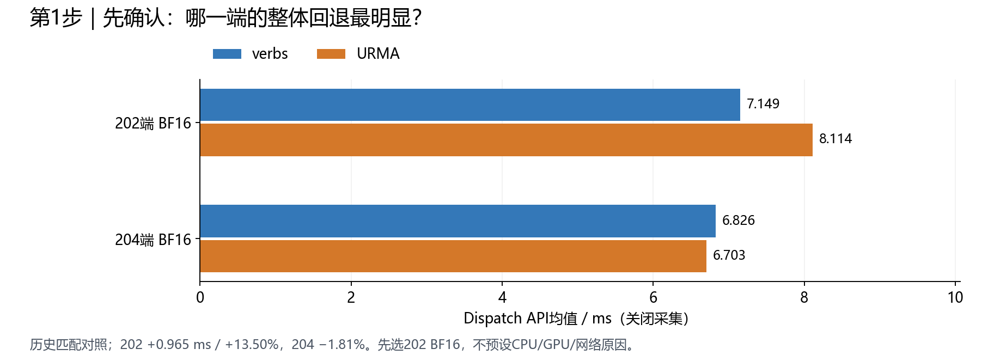
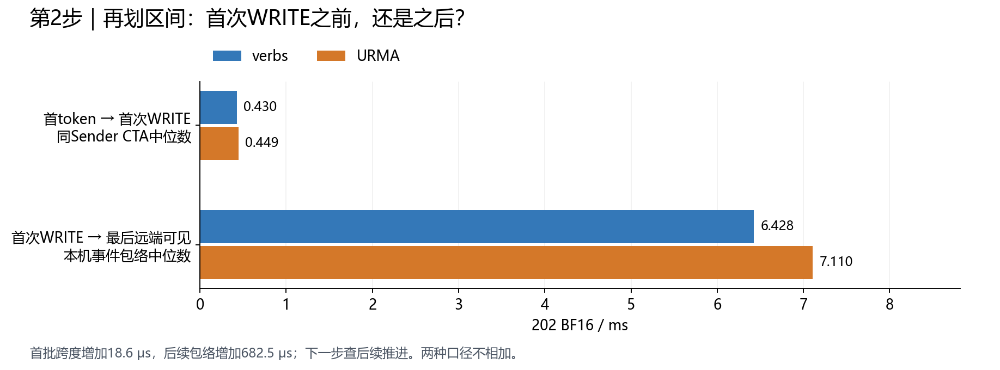
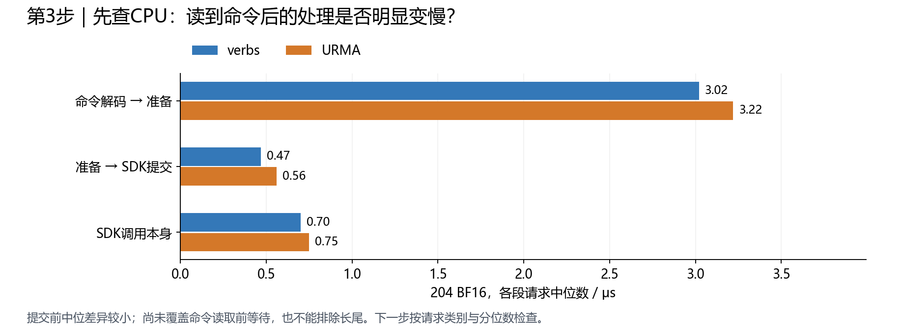
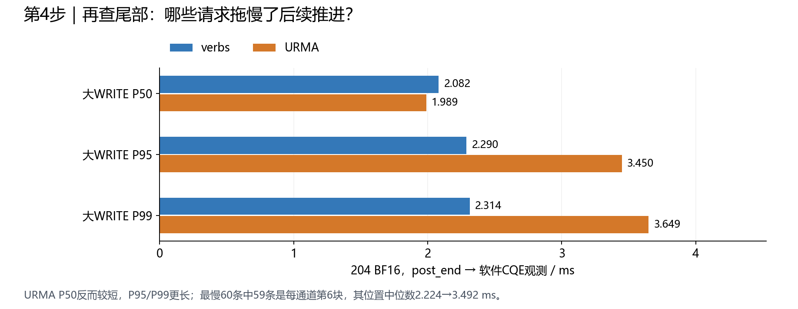
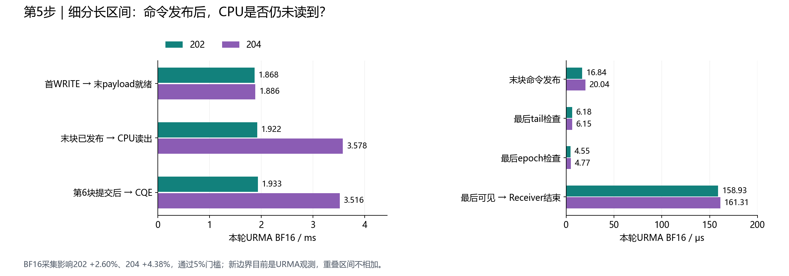
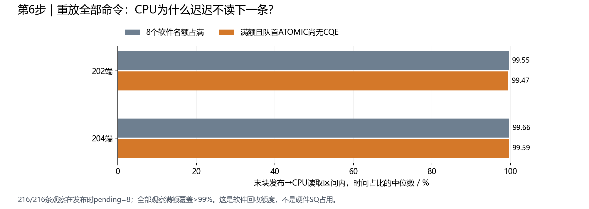
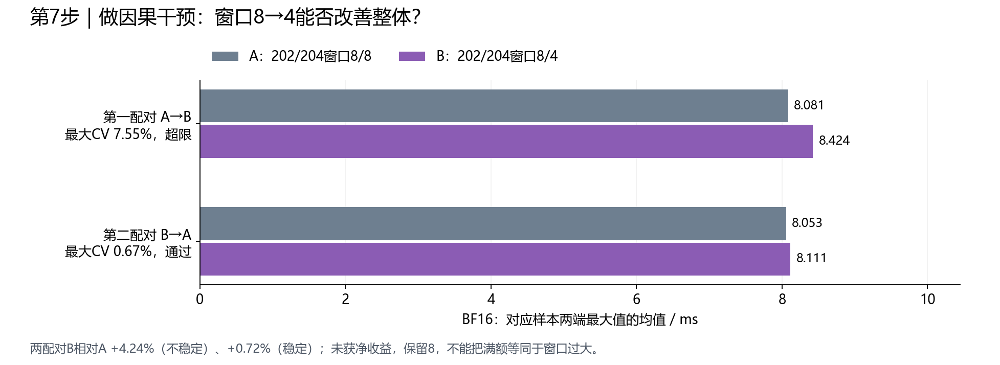
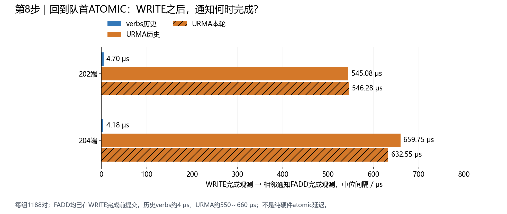

# Normal回退定位：按证据递进展开的八步汇报

补充专题：[WRITE排序、通知FADD与FIFO阻塞的数据及分析](../normal_order_notify_review_20261112/README.zh-CN.md)，集中说明两种请求的路径、顺序约束、完成回执及历史WRITE强弱序A/B结果。

本版用于讲清调查过程，每一步先给数据，再给当时能支持的判断和下一步理由。第一步不先宣布最终根因。原一页总览适合在本版之后作为结论页。

范围是Normal BF16、4096 tokens、hidden7168、experts256、topk8，SM24、Dispatch chunk32、NVL chunk4，两端各一张C500。历史verbs/URMA的内核、设备及SDK不同；图中保留历史匹配对照与本轮URMA观测的区别。每组通常9个有效API样本；132大WRITE/窗×9窗=1188条请求，12通道×9窗=108条特定位置观测，不当成1188轮独立实验。

## 1. 先确认整体问题：哪一端、哪种负载值得优先查

关闭采集的历史匹配对照，API均值，单位ms：

| 节点/BF16 | verbs | URMA | 变化 |
| --- | ---: | ---: | ---: |
| 202 | 7.149 | 8.114 | **+0.965ms / +13.50%** |
| 204 | 6.826 | 6.703 | −1.81% |

FP8的202/204变化分别+4.17%/+2.76%，小于202 BF16。Combine的paced和on小差距方向不一致，未作为稳定回退。

**这时只知道：** 202 BF16有较明确的整体差额；还不能认定CPU、GPU、网络或哪个算子负责。

**所以下一步：** 拆开Dispatch，先判断首次WRITE前还是之后更值得研究。204向202发送数据，也需同时查看204端。

数据：[api_comparison.csv](../backend_matched_comparison_01/api_comparison.csv)。

## 2. 粗分GPU区间：把调查范围收窄到首次WRITE之后

202 BF16，单位ms：

| 区间 | verbs | URMA | 差额 |
| --- | ---: | ---: | ---: |
| 首token→首次WRITE，同Sender CTA中位跨度 | 0.430 | 0.449 | **约0.019** |
| 首次WRITE→最后远端token可见，本机事件包络中位数 | 6.428 | 7.110 | **约0.682** |

**这时得到：** 首批准备跨度差异较小，较大的候选差异在首次WRITE之后的持续推进。还不能把该包络直接称为网络时间、Proxy计算时间或GPU计算时间。

**所以下一步：** 查同一期间CPU命令处理与提交记录，先看命令读出后的工作。

数据：[gpu_span_comparison.csv](../backend_matched_comparison_01/gpu_span_comparison.csv)。两行口径不同且含并行角色，不相加，不用0.682/0.965计算已解释的整体回退比例。

## 3. 查看CPU命令处理：读到命令之后，是否明显变慢

204 BF16，完整业务链中各段独立中位数，单位μs：

| CPU区间 | verbs | URMA |
| --- | ---: | ---: |
| decoded→prepare | 3.02 | 3.22 |
| prepare→post_begin | 0.47 | 0.56 |
| SDK post_begin→post_end | 0.70 | 0.75 |

**这时得到：** 上述提交前区间没有呈现毫秒级差别，没有足够依据将主要问题归到“CPU读出命令后的计算或SDK调用本身”。但这不覆盖CPU读取之前的排队，也不能拿中位数排除少数长尾。

**所以下一步：** 将请求按WRITE/ATOMIC等类别分开，并从中位数继续看P95/P99。

数据：[cpu_stage_comparison.csv](../backend_matched_comparison_01/cpu_stage_comparison.csv)。这些段在并行请求中分别取中位数，不按请求数简单累加到API上。

## 4. 查看请求长尾与位置：发现204第6块大WRITE异常集中

204 BF16大WRITE的post_end→软件CQE观测间隔，单位ms：

| 分位数 | verbs | URMA |
| --- | ---: | ---: |
| P50 | 2.082 | 1.989 |
| P95 | **2.290** | **3.450** |
| P99 | **2.314** | **3.649** |

URMA中位数较短，但尾部更长。进一步按每个Proxy/ring/window的大WRITE发出顺序审查：URMA最慢5%的60条中，**59条在每通道第6块**；第6块108条观测的中位数为verbs **2.224ms**、URMA **3.492ms**。

**这时得到：** 完成推进存在集中长尾，第6块及其前序命令有具体调查价值。这仍不等于已知道长尾由设备、依赖、轮询或FIFO反压哪个因素造成。

**所以下一步：** 在已知长区间中补稀疏边界，特别记录第6块和末块准备/发布，以及接收端tail/epoch/输出收尾。

数据：[cpu_completion_tails.csv](../backend_matched_comparison_01/cpu_completion_tails.csv)、[payload_positions.csv](../window_audit_01/payload_positions.csv)、[长尾位置计数](../window_audit_01/context.json)。CQE是软件观测，不是纯传输计时。

过程中的候选修正：曾审查混合提交差异，但同为459264B的204 URMA WRITE，混合组P95为2.952ms（553条），非混合组为3.601ms（527条），不支持优先认定混合提交有害，因此暂停该A/B。观察分组不等于随机实验，亦不能反向证明混合更优。

## 5. 新增边界：发现末块已经发布，但CPU很晚才取到

先验收观察器：BF16 trace相对前后关闭采集均值影响202 **+2.60%**、204 **+4.38%**，CV/漂移通过原5%门槛，正确性与覆盖通过、零丢记录。FP8未通过对照，不用于本次归因。

本轮URMA BF16区间中位数：

| 区间 | 202 | 204 |
| --- | ---: | ---: |
| 首WRITE→末payload就绪 | 1.868ms | 1.886ms |
| 末块命令发布及通知 | 16.84μs | 20.04μs |
| 末块命令发布后→CPU读出 | **1.922ms** | **3.578ms** |
| 第6块post_end→CQE | 1.933ms | **3.516ms** |
| 最后tail检查 | 6.18μs | 6.15μs |
| 最后token epoch检查 | 4.55μs | 4.77μs |

**这时得到：** 已知的大间隔出现在“GPU命令已发布，但CPU尚未读取”以及提交后的推进；本批正式形状的最后一次tail/epoch检查没有同等级别等待。CPU读到末块之后，准备约3μs、准备到提交约0.9μs。

**所以下一步：** 不再笼统说CPU Proxy慢，而是检查CPU为什么没有继续读FIFO。

数据：[边界中位数](../urma_boundaries_01_summary/boundary_medians.csv)、[CPU第6块和末块](../urma_boundaries_01_summary/cpu_chunk6_and_last.csv)、[发布后到读取的重建记录](../urma_boundaries_01_fifo_audit/last_write_fifo.csv)、[观察器控制](../urma_boundaries_01_summary/api_controls.csv)。新增边界目前仅是本轮URMA观测，没有对应verbs新边界差值；跨角色、重叠区间不相加。

另一项修正：128-token smoke的末块tail总跨度约202/204 331.52/291.21μs，4096-token正式负载没有延续，不能推广小形状线索。短区间受读钟开销影响；整体5%验收不意味着每个内部区间零扰动。

## 6. 重放FIFO：解释CPU为什么迟迟不取下一条

无需新实机测试。按全部命令collect入队、ack_slot按序出队，重建软件pending；包含控制命令，拒绝重复、缺失、越序或超额度记录。

对“末块发布→CPU读出”区间积分，逐通道占比的中位数：

| 观察 | 202 | 204 |
| --- | ---: | ---: |
| 8个软件未回收名额占满 | **99.55%** | **99.66%** |
| 满额且队首ATOMIC尚无CQE观测 | **99.47%** | **99.59%** |

216/216条观察发布时pending全部为8；每条观察满额覆盖均超过99%。源码只允许按序回收，队首未完成便停止；budget=max(8−pending,0)，满额时不继续poll新命令。

直接例子：204同一窗口/通道，WRITE wr4102在5.949ms已观察到CQE，但前序ATOMIC wr4101到6.262ms才完成，所以WRITE也到6.262ms才回收，最后payload到6.264ms才被CPU读出。所有时间均相对本端origin。

**这时得到：** 已确认当前等待机制——前序ATOMIC完成观测较迟，按序回收受阻，软件额度占满，后续命令不能及时读取。8不是硬件SQ深度，占比也不是整个Dispatch的占比。

**所以下一步：** 验证这种等待是否被过高并发放大，不能仅凭“队列满”就认定“窗口8过大”。

数据：[fifo_medians.csv](../urma_boundaries_01_fifo_audit/fifo_medians.csv)、[216条区间](../urma_boundaries_01_fifo_audit/last_write_fifo.csv)、[重建与代码机制](../urma_boundaries_01_fifo_audit/ANALYSIS.zh-CN.md)。

## 7. 做单变量干预：204窗口8→4没有带来净收益

如果过高并发放大了完成等待，减小窗口可能改善整体；如果只是减少并行度，也可能无益或更慢。为此仅改变204，202保持8，关闭采集按ABBA运行。

BF16主指标为对应样本两端最大值的均值，单位ms：

| 配对 | A：8/8 | B：8/4 | B变化 | 最大CV |
| --- | ---: | ---: | ---: | ---: |
| r01 A→B | 8.081 | 8.424 | **+4.24%** | **7.55%，超限** |
| r02 B→A | 8.053 | 8.111 | **+0.72%** | **0.67%，通过** |

**这时得到：** 未取得原定两轮均改善≥5%的收益。第一轮不能当稳定退化幅度；第二轮稳定，却仍无明显改善。保留8，不继续扫窗口或补该实验trace。

这个阴性结果不否定FIFO满额事实，但没有支持“窗口8过大就是主要回退原因”。

**所以下一步：** 回到占住队首的ATOMIC，直接对齐它与对应WRITE的提交、完成时刻，不再继续猜窗口大小。

数据：[rounds.csv](../urma_window_after_boundaries_01_summary/rounds.csv)、[完整结果解释](../urma_window_after_boundaries_01_summary/ANALYSIS.zh-CN.md)。

## 8. 逐对核查通知：WRITE完成观测后，FADD仍明显较晚完成观测

继续复用既有日志，不新增服务器任务。逐对要求同Proxy/ring、相邻命令、同endpoint、单次物理提交/完成，且payload字节=通知token数×14352B；每组1188对，全纳入。

WRITE CQE→对应通知FADD CQE的中位间隔，单位μs：

| 数据组 | 202 | 204 |
| --- | ---: | ---: |
| 历史verbs | **4.70** | **4.18** |
| 历史URMA | **545.08** | **659.75** |
| 本轮URMA | **546.28** | **632.55** |

六组7128对中，FADD全部已在对应WRITE完成观测前提交。本轮204 FADD post_end通常比WRITE CQE提前约1.508ms（独立中位数），但WRITE已有CQE之后，仍约632.55μs才观察到对应FADD完成。因此不能仅解释成“WRITE完成后CPU才发通知”。

**到这一步，才进一步收窄当前调查目标：** 通知FADD提交后的完成推进，是两后端存在明显观测差异、并与FIFO回收阻塞相吻合的具体路径。

数据：[notify_pair_summary.csv](../notify_completion_audit_01/notify_pair_summary.csv)、[全部7128对](../notify_completion_audit_01/notify_pairs.csv)、[配对方法与限制](../notify_completion_audit_01/ANALYSIS.zh-CN.md)。历史与本轮分别标注，不能将不同campaign同号样本当成同步配对。

## 在证据链末尾给出的阶段性判断

最初只能说202 BF16整体慢约13.5%；经过区间划分、请求长尾、边界打点、FIFO重放、减窗干预和通知配对，现在能够具体说：

**已观察到ATOMIC完成推进较迟、软件FIFO按序回收受阻、后续WRITE命令排队；其中通知FADD在WRITE完成观测后仍明显迟完成，是当前优先调查路径。**

尚未唯一确定顺序/fence、设备队列、远端atomic访问或软件完成观测分别贡献多少。两个CQE的间隔不等同纯硬件atomic延迟；WRITE CQE不测GPU实际可见时刻。FIFO逻辑两后端共享，新增边界还缺verbs同口径对照，不能把URMA的3.578ms全部当成相对verbs的净差额。

以上是调查范围逐步收窄的证据链，不是可以相加的完整关键路径，也没有先选ATOMIC再倒推数据。

## 图表使用

八步均有独立PNG及SVG，可逐页使用；figure_sources.json保留输入摘要。重绘使用tools/reference_events/plot_evidence_steps.py，输出目录须不存在，Linux显式指定中文字体。该程序不启动GPU测试。
