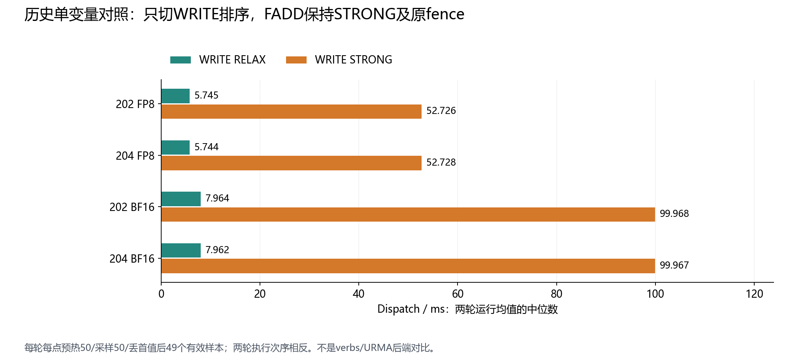
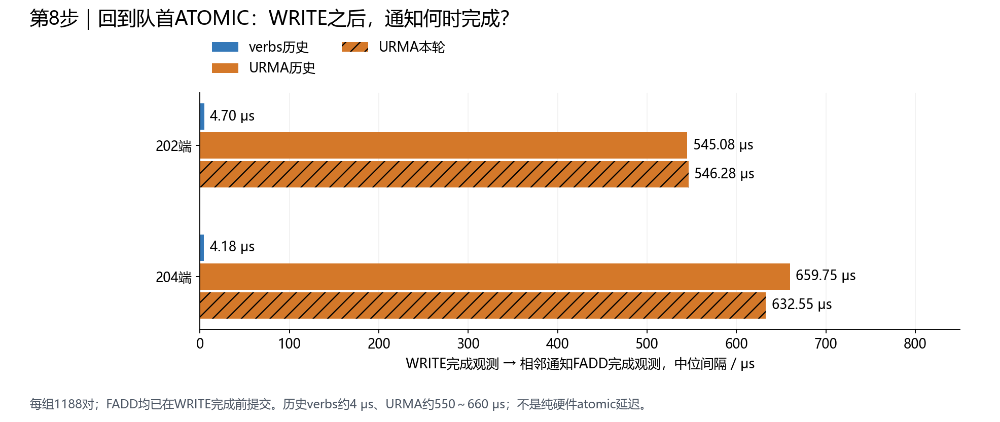

# URMA Normal：WRITE排序、通知FADD与FIFO阻塞的实验数据及分析

本报告整理目前讨论到的请求路径、顺序关系、完成回执含义和实验结果。适用范围是当前MetaX Normal跨节点Dispatch的payload WRITE及对应tail通知FADD；不将它与barrier控制endpoint上的FADD混同。

完整定位过程仍按[八步证据递进版](../normal_evidence_steps_20261112/README.zh-CN.md)讲解，本报告作为“排序和通知机制”专题补充。

## 1. 两个请求分别走什么路径

以204向202发送32个token为例：WRITE把payload写入对端接收区；FADD对对端tail计数器原子加32，例如64→96，发布新的接收进度。

```text
共同命令通路：
204 GPU kernel → 同channel的GPU→CPU FIFO → CPU Proxy → URMA数据Jetty

WRITE的数据操作：
204 GPU发送区 → URMA设备/链路 → 202 GPU接收数据区

FADD的原子操作：
URMA设备/链路 → 202 GPU控制区执行tail += 32
             → 旧值返回204主机暂存区

本地完成处理：
完成队列 → 204 CPU轮询到成功记录 → 已完成集合 → FIFO按序回收
```

| 项目 | WRITE | 通知FADD |
| --- | --- | --- |
| 作用 | 搬运一块token数据 | 更新这块数据对应的生产进度 |
| 命令携带 | 本地/远端地址、长度 | 远端计数器地址、增量 |
| 当前MetaX目标内存 | 对端GPU数据缓冲区 | 对端GPU控制缓冲区 |
| 当前后端操作 | URMA_OPC_WRITE | URMA_OPC_FADD |
| 配对请求的endpoint | 按同一ring映射到同一个数据Jetty | 与该WRITE相同 |
| 本端结果 | WRITE完成记录 | 旧值写回主机暂存区及FADD完成记录 |

Proxy负责读取和提交命令，payload经注册GPU内存传输。两种操作都由URMA transport执行。GPU侧接口名是amo_nonfetch_add，算法不使用旧值，但后端实际采用FADD并提供旧值写回空间；verbs对应路径也使用IBV_WR_ATOMIC_FETCH_AND_ADD，不能将“有旧值返回”单独说成URMA独有开销。

源代码：[GPU WRITE/ATOMIC命令](../../../../ep/include/uccl_ibgda.cuh)、[Normal发布顺序与接收逻辑](../../../../ep/src/internode.cu)、[URMA操作构造及轮询](../../../../ep/src/urma_transport.cpp)、[同ring数据lane映射](../../../../ep/include/urma_mode.hpp)、[MetaX控制内存类型](../../../../ep/src/gpu_p2p_runtime.cpp)。

## 2. 要区分四种顺序

| 层次 | 当前逻辑 | 不能混同的概念 |
| --- | --- | --- |
| 程序发布顺序 | 同批先发布WRITE命令，再发布tail FADD，映射同channel/FIFO/数据Jetty | 不要求CPU先收到WRITE CQE再提交FADD |
| 设备事务顺序 | Normal WRITE RELAX；FADD STRONG，并按请求保留fence，本批通知请求为fence=true | WRITE弱序不等于整个流程没有顺序约束 |
| 完成记录上报 | 本轮completion=all，WRITE与FADD分别产生完成记录；没有使用ordered/paired策略额外绑定完成或抑制WRITE CQE | 事务顺序、完成记录上报顺序、CPU发现时刻不是同一个时间点 |
| 接收端消费顺序 | 接收GPU观察tail前进，再检查token epoch/tag，满足条件后处理 | 不能只凭tail前进或发送端CQE断言GPU已消费数据 |

公开URMA API文档将place_order、comp_order、fence分开定义。其中，STRONG的事务约束涉及排序范围内此前标记RELAX/STRONG的请求；fence等待此前READ和ATOMIC完成后再发送当前请求。因此，fence不是“只等待对应WRITE”的同义词，FADD还可能受其他前序请求影响。具体私有SDK/设备在本环境中的依赖推进和等待范围仍需验证。[openEuler URMA API文档](https://docs.openeuler.org/zh/docs/24.03_LTS_SP3/unifiedbus/unifiedbus/urma/URMA%20API%20Guide.ch.html)

这里的正确性要求是接收端在数据有效并已获得进度信息后消费；当前实现由发布顺序、传输约束及接收端epoch检查共同实现。现有数据不能证明FADD的STRONG/fence可直接取消，也不能反向认定所有现有约束都不可优化。

## 3. 图中“WRITE完成到FADD完成”到底是什么

两端的数据均由发送端CPU轮询本地完成队列获得：

```text
CPU观察到WRITE成功完成记录
              ↓
      本图统计的时间间隔
              ↓
CPU观察到对应通知FADD成功完成记录
```

FADD在该区间开始前已经提交，不是CPU收到WRITE回执后才临时发送。FADD本身可能正在等待依赖、远端执行、结果返回或完成记录被消费；现有时间点不能拆开这几个部分。

尤其要区分两件事：远端tail什么时候更新、被接收GPU看到；发送端CPU什么时候看到FADD CQE。两者不同。接收端可能已开始处理，但发送端仍未观测到完成。因而约633μs不能解释为接收GPU必然空等633μs，也不是纯硬件atomic单操作时延。

## 4. 没收到FADD完成，哪些环节受影响

| 环节/条件 | 能否继续 |
| --- | --- |
| 接收GPU已观察tail前进且epoch有效 | 可以处理该批数据，不等待发送端CPU收到CQE |
| 接收GPU尚未看到该批tail进度 | 当前协议下不能据此开始处理该批，仍需等进度及数据有效条件 |
| 发送端同FIFO尚有软件额度 | 可以继续读取/提交后续命令，直到额度受限 |
| FADD成为未完成队首 | 不能越过它回收后面的请求，即使后面某个WRITE已有CQE |
| 同FIFO未回收命令达到默认8个 | Proxy不再读取该FIFO新命令；其他有条件推进的通道不被这一条回执直接全局禁止 |
| quiet/drain或相关barrier阶段要求先排空未完成操作 | 相关阶段需要等待，不能提前报告排空完成 |

```text
WRITE1：完成，可回收
FADD1 ：未完成，成为队首
WRITE2：已有CQE，但不能越过FADD1回收
……未回收累计到8 → 暂停读取这个FIFO的新命令
```

源代码：[Proxy轮询/按序回收/读取新命令](../../../../ep/src/proxy.cpp)、[GPU quiet/barrier等待](../../../../ep/include/uccl_ibgda.cuh)。

## 5. 实验一：WRITE强序/弱序确实影响Normal性能

历史单变量A/B只改变WRITE placement；FADD保持STRONG和原fence，completion=all，其余GPU程序、lane、FIFO、缓冲区、完成策略保持。两轮执行次序相反，8个成功case正确性均通过。每轮每点预热50、计时50、丢首值，49个有效样本。

每列为各节点两轮运行均值的中位数，单位ms：

| 节点 | Dispatch | WRITE RELAX | WRITE STRONG | STRONG/RELAX |
| --- | --- | ---: | ---: | ---: |
| 202 | FP8 | 5.745 | 52.726 | 9.178× |
| 204 | FP8 | 5.744 | 52.728 | 9.180× |
| 202 | BF16 | 7.964 | 99.968 | **12.553×** |
| 204 | BF16 | 7.962 | 99.967 | **12.555×** |



结论：当前环境下WRITE使用STRONG明显更慢，保留Normal WRITE RELAX。该组是历史49样本A/B，不将7.964ms与当前9样本paced的8.114ms相减解释为版本性能变化。

更关键的边界：**目前URMA仍落后于verbs的有效基线已经使用WRITE RELAX。** 因而剩余回退不能简单归为“误用了WRITE STRONG”；WRITE排序A/B也没有单独验证FADD弱序或关闭fence的效果与正确性。

数据：[原始排序汇总CSV](../../../urma_mode_parity/results/urma_normal_order_current_02/summary/order_comparison.csv)、[既有复核报告](../../../urma_mode_parity/results/NORMAL_ORDER_REVIEW.zh-CN.md)。第三轮预检查未完成，不计入有效结果；没有为了补第三轮机械重跑。

## 6. 实验二：WRITE弱序基线仍存在202 BF16整体差额

历史匹配paced、关闭采集的API均值，9个有效样本，单位ms：

| 节点/BF16 | verbs | URMA | 变化 |
| --- | ---: | ---: | ---: |
| 202 | 7.149 | 8.114 | **+0.965ms / +13.50%** |
| 204 | 6.826 | 6.703 | −1.81% |

URMA此时为WRITE RELAX、FADD STRONG/fence保留、completion all。两后端有内核、设备、SDK差异，不能当成只换软件开关的对照。

该阶段粗打点将202较大的候选差异收窄到首次WRITE之后：后续数据可见性包络6.428→7.110ms，增加约0.682ms；同Sender CTA的首token→首WRITE仅0.430→0.449ms，增加约19μs。不同角色/口径，不相加成完整关键路径。

数据：[整体API对照](../backend_matched_comparison_01/api_comparison.csv)、[GPU区间对照](../backend_matched_comparison_01/gpu_span_comparison.csv)。

## 7. 实验三：通知FADD完成推进出现具体差异

在同Proxy/ring、相邻命令、同endpoint且通知token数与payload字节严格匹配的WRITE/FADD之间，比较两次CQE的本地软件观测时刻。每组9窗×132对=1188对，六组共7128对，全纳入。

WRITE CQE→FADD CQE，中位数，单位μs：

| 数据集 | 202 | 204 |
| --- | ---: | ---: |
| 历史verbs匹配采集 | **4.70** | **4.18** |
| 历史URMA匹配采集 | **545.08** | **659.75** |
| 本轮URMA边界采集 | **546.28** | **632.55** |



六组中每组1188/1188个FADD均已在对应WRITE CQE之前提交。本轮204的FADD post_end相对WRITE CQE通常提前约1.508ms，但之后仍观察到约632.55μs的成对CQE间隔；两者是独立中位数，不进行代数相加。

这支持优先调查FADD提交后的依赖、执行与完成推进，不能只解释为CPU在WRITE完成之后才提交通知。它仍不是纯硬件atomic延迟；顺序/队列、远端原子访问、结果返回、完成发布及轮询都可能进入口径。

数据：[成对统计](../notify_completion_audit_01/notify_pair_summary.csv)、[全部7128对](../notify_completion_audit_01/notify_pairs.csv)、[配对方法和限制](../notify_completion_audit_01/ANALYSIS.zh-CN.md)。本轮BF16采集相对前后控制均值变化202 +2.60%、204 +4.38%，通过原5%工程门槛；FP8未通过，未用于本结论。

## 8. 实验四：FIFO回收阻塞及窗口阴性干预

本轮URMA BF16末块命令发布后到CPU读出的间隔中位数为202 **1.922ms**、204 **3.578ms**。按全部collect/ack_slot重放FIFO，包含控制命令：

| 逐通道时间占比中位数 | 202 | 204 |
| --- | ---: | ---: |
| 8个软件名额占满 | **99.55%** | **99.66%** |
| 满额且队首ATOMIC尚无CQE观测 | **99.47%** | **99.59%** |

每端108条观察，216条发布时pending全部为8，每条满额覆盖均>99%。这些比例只针对末块发布→CPU读取区间，不是整个Dispatch的占比，也不是硬件SQ深度。

接着202保持8、204从8改4，关闭采集做ABBA，BF16两端对应样本较大值的均值：

| 配对 | A窗口8/8 | B窗口8/4 | B变化 | 最大CV |
| --- | ---: | ---: | ---: | ---: |
| r01 A→B | 8.081ms | 8.424ms | +4.24% | 7.55%，超限 |
| r02 B→A | 8.053ms | 8.111ms | +0.72% | 0.67%，稳定 |

未获得净收益，保留8，不继续窗口扫描或补该实验trace。这不否定满额等待，但未支持“窗口8过大就是主要回退原因”。

数据：[FIFO重放统计](../urma_boundaries_01_fifo_audit/fifo_medians.csv)、[逐通道记录](../urma_boundaries_01_fifo_audit/last_write_fifo.csv)、[窗口对照结果](../urma_window_after_boundaries_01_summary/ANALYSIS.zh-CN.md)。

## 9. 当前能作出的分析

| 分层判断 | 当前证据支持程度 |
| --- | --- |
| WRITE强弱序影响Normal性能 | **已通过单变量实验证明**；当前环境STRONG显著更慢，保留RELAX |
| 剩余回退来自误用WRITE STRONG | **不支持**；剩余差额和阶段记录已经使用RELAX |
| ATOMIC迟完成观测与FIFO回收阻塞 | **已直接观察到机制**；队首未完成、额度用满，后续命令晚读取 |
| 通知FADD完成推进存在后端差异 | **已看到可重复的观测差异**；verbs约4μs、URMA约550～660μs |
| 窗口8过大可通过改4解决回退 | **未得到干预支持**；不继续扫描 |
| FADD STRONG/fence就是唯一根因 | **尚未证明**；它是有实现依据的候选，缺少单独干预及正确性验证 |
| 可以直接将FADD改弱序/去fence | **尚无依据**；WRITE A/B不能外推FADD正确性和收益 |
| 约633μs就是GPU空等或硬件atomic耗时 | **不能据此解释**；它是两次本地软件完成观测的间隔 |

进一步判断FADD顺序约束是否造成额外等待，需要把依赖约束、远端atomic访问、结果/完成推进区分开，并对任何放宽约束验证数据正确性、缓冲区复用、通知及排空语义。当前实验尚未完成这一因果区分，不将候选写成唯一根因。

本报告未提出重复运行已完成的WRITE排序、smoke、边界三项或窗口ABBA。现有结果及阴性结果均保留。

下一项因果验证已准备：[204端Normal数据FADD fence单变量实验与运行步骤](../../FADD_FENCE.zh-CN.md)。保留FADD STRONG，只切换204数据通道fence，先验证正确性，再关闭采集做ABBA；这是一项待执行实验，不是本报告已经取得的结论。

## 10. 图表与来源核查

- WRITE排序新图：[PNG](write-order-impact.png)、[矢量SVG](write-order-impact.svg)，figure_source.json记录原始CSV摘要及计算值。
- 通知/FIFO/窗口/阶段数据直接链接已有提交结果，不制作拼接的可相加时延柱。
- data_manifest.json记录本报告核心数据文件SHA256；数值由现有CSV核对，图表不生成合成实验数据。
- 代码语义来自当前仓库；公开API定义来自上文openEuler文档，不能替代当前私有SDK/设备的实际行为验证。
