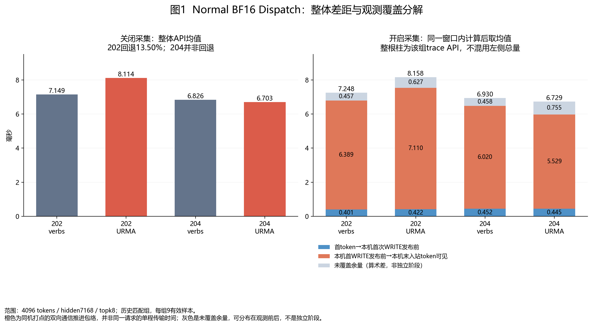
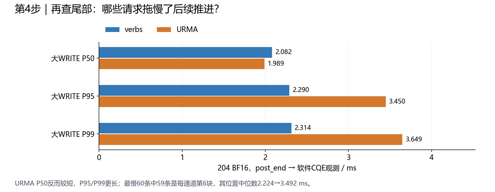
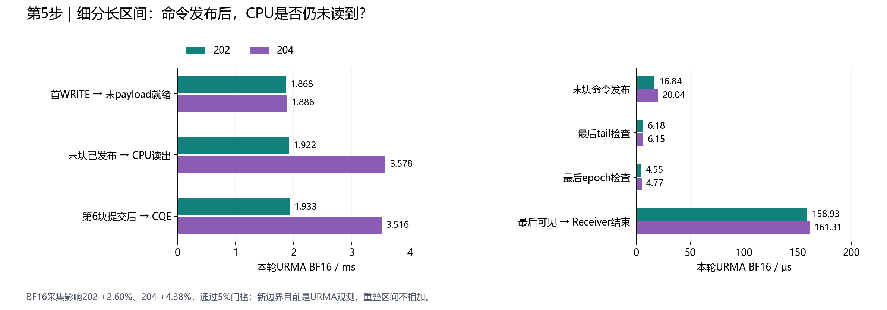
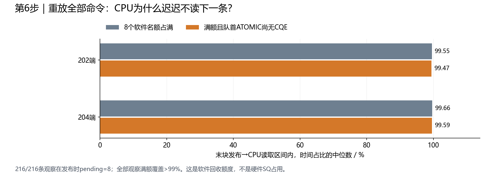
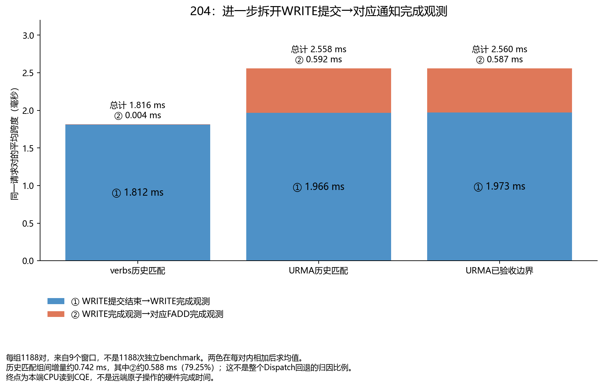
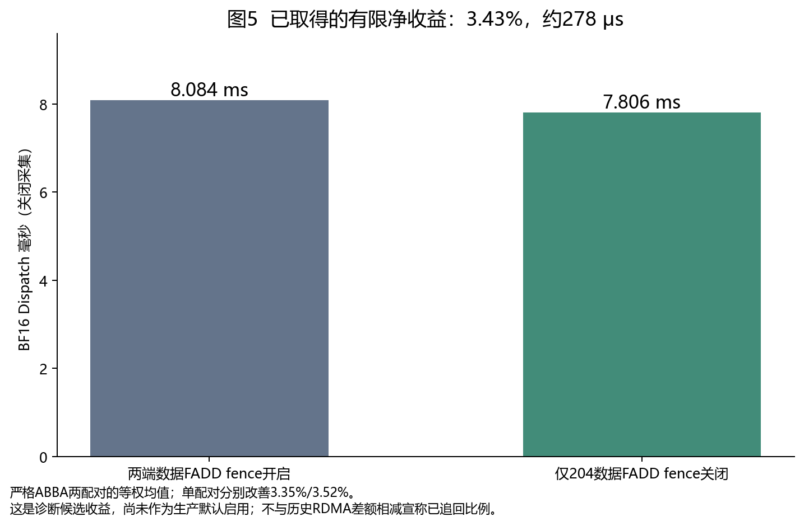
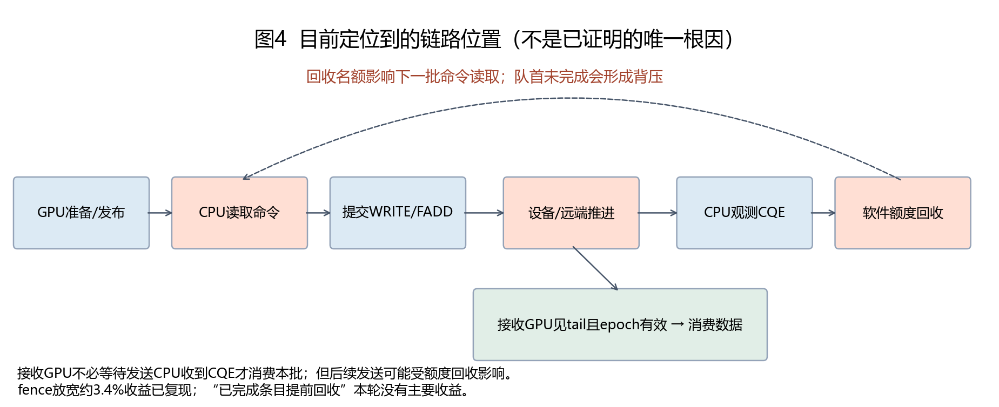

# Normal性能回退：从整体差距到通知完成推进的定位过程

更新：2026-11-16；最新实验输入：b7c32dd6（urma_retire_01）。本文按调查顺序组织数据，说明**每一步为什么做、看到了什么，以及如何决定下一步**。原详细记录保留在[技术附录](TECHNICAL_APPENDIX.zh-CN.md)，本页是统一阅读入口。

**目前的结论：我们从202端Normal BF16 Dispatch约13.5%的整体回退，逐步定位到了“通信请求提交后，尤其是对应通知FADD的完成推进较迟，并通过软件额度影响后续命令读取”这条链路。放宽204数据FADD的fence约束取得约3.4%的部分净收益；简单缩窗、提前回收已完成请求，没有取得主要净收益。尚未把剩余等待进一步分清为设备依赖、远端原子访问、返回/CQE生成或CPU发现完成各占多少。**

## 先看整条调查路线

| 步骤 | 当时要回答的问题 | 决定方向的关键数据 | 因此转向哪里 |
| --- | --- | --- | --- |
| 1 整体对照 | 哪个负载、哪一端确实慢？ | 202 BF16：7.149→8.114ms，+13.50%；204没有同方向回退 | 优先分析202 BF16，同时检查给202发数据的204 |
| 2 粗分区间 | 首批准备慢，还是通信开始后推进慢？ | 202同窗均值：首token→首WRITE约0.401/0.422ms；之后包络6.389/7.110ms | 进入首次WRITE后的持续通信链路 |
| 3 CPU与请求长尾 | CPU处理慢，还是请求推进慢？ | CPU准备/提交仅数μs；204大WRITE P95为2.290/3.450ms，URMA长尾集中第6块 | 在具体chunk周围补边界 |
| 4 发布与读取 | 数据未准备好，还是已发出命令未推进？ | URMA末块已发布→CPU读出：202 1.922ms、204 3.578ms | 查CPU为什么不能继续读命令 |
| 5 FIFO重放 | CPU不读下一条时在等什么？ | 上述区间超99%额度占满，队首ATOMIC尚无完成观测 | 检查窗口大小及占住额度的ATOMIC |
| 6 缩窗验证 | 是并发8过大造成的吗？ | 窗口8→4：+4.24%（不稳定）/+0.72%（稳定），没有收益 | 停止扫窗口，直接配对WRITE与通知 |
| 7 请求配对 | WRITE和对应FADD之间哪段差得大？ | 204 WRITE完成→对应FADD完成观测：verbs中位4.18μs、URMA659.75μs | 审查通知顺序约束的实现差异 |
| 8 fence干预 | 该约束是否真的影响整体性能？ | 两配对改善3.35%/3.52%，等权均值节省277.52μs | 确认部分可优化代价，继续检验等待如何传导 |
| 9 提前回收干预 | 按序回收本身是不是主要修复点？ | 一致指纹配对仅改善1.37%；另一配对0.64%且指纹漂移 | 不采用该策略，重心保留在尚未完成的通知推进与依赖 |

下文逐步给出依据。这些数据不是可逐项相加的API关键路径。

## 共同配置与读图约定

主线负载为Normal BF16：4096 tokens、hidden7168、experts256、topk8、SM24、Dispatch chunk32，两节点各一张MetaX C500、GPU0。202是rank0，204是rank1，**两端均同时发送和接收**；并不是202固定发送、204固定接收。verbs和URMA使用各自适用的内核、设备及SDK。

历史匹配组每端9个有效API窗口；1188对请求来自9个窗口，不能称为1188次独立benchmark。“完成观测”均指本端CPU读到CQE，既不等同远端GPU看到payload，也不等同硬件刚完成操作的时刻。各表注明均值、中位数或P95，不跨口径相加。

## 第1步：先确认值得解释的整体差距

关闭采集的历史匹配基线，整次Dispatch API均值：

| 节点 | verbs | URMA | URMA相对变化 |
| --- | ---: | ---: | ---: |
| 202 | 7.14874ms | 8.11395ms | **+0.96521ms / +13.50%** |
| 204 | 6.82638ms | 6.70259ms | −0.12379ms / −1.81% |

FP8两端变化约+4.17%/+2.76%，小于202 BF16；此前Combine对照没有得到同样稳定的回退方向，因此本阶段集中调查Normal BF16 Dispatch。

**这一步只确定问题，没有确定原因。** 202调用变长，也可能因为它等204的数据变久。下一步必须同时看两端，不能直接把总差额归给202的GPU计算或CPU Proxy。

## 第2步：粗分Dispatch，把范围收窄到通信开始后的推进



左图是第1步关闭采集的基线。右图另取同一trace窗口内的API和事件，先逐窗口计算、再对9个窗口求均值：

| 节点/后端 | 首token→本机首WRITE发布前 | 本机首WRITE发布前→本机末入站token有效 | 未覆盖余量 | 同窗API总量 |
| --- | ---: | ---: | ---: | ---: |
| 202 verbs | 0.40117ms | **6.38910ms** | 0.45749ms | 7.24776ms |
| 202 URMA | 0.42152ms | **7.11029ms** | 0.62652ms | 8.15832ms |
| 204 verbs | 0.45187ms | 6.02027ms | 0.45786ms | 6.93001ms |
| 204 URMA | 0.44526ms | 5.52855ms | 0.75543ms | 6.72924ms |

202首批准备覆盖只差约20μs；通信开始后的包络差约721μs，更值得细分。因此我们进入首次WRITE后的链路，而不是优先优化首批数据准备。

橙色表示**本机双向Dispatch推进窗口**，以202为例：

```text
202发送：E1首WRITE发布前 → 持续准备/分批发布WRITE和FADD → CPU/设备发送 → 204
202接收：204持续发送 → 数据与tail到202 → 202检查epoch → E2最后入站token有效
         两条支路、多通道和多个chunk并行；E1和E2均记录在202
```

E1位于GPU调用Normal put_nbi_warp之前，还未到CPU/SDK实际提交；E2位于本机Forwarder确认最后入站token的epoch有效之后。它不是同一条WRITE的起终点，也不是“202发出的最后一条数据在204被确认”。

中间包含后续token整理、chunk发布、GPU→CPU FIFO、CPU提交、设备/远端推进、tail/epoch检查、head反馈与额度回收。**橙色更长说明整体推进慢，尚不能判定哪一项慢。**

灰色是API减去两个覆盖区间的算术余量，未单独打点，可能位于观测前后；不能称为独立GPU计算或收尾阶段。API与采样事件也有计时域误差。右图用于收窄范围，不计算“已解释整体回退的百分比”。旧报告6.428/7.110ms是中位数，本表统一使用同窗均值。

## 第3步：先查CPU处理，再查请求长尾，发现具体可追踪位置

204 CPU读到命令以后的处理，历史完整业务链的各段独立中位数：

| CPU区间 | verbs | URMA |
| --- | ---: | ---: |
| decoded→prepare | 3.02μs | 3.22μs |
| prepare→post_begin | 0.47μs | 0.56μs |
| SDK post_begin→post_end | 0.70μs | 0.75μs |

这些差异远小于毫秒级回退，**没有支持“CPU读到命令后算得明显更慢”**。但读取前排队和提交后等待仍未解释，因此继续按请求类型看分布。

204大WRITE从提交结束到CPU观测CQE：

| 分位数 | verbs | URMA |
| --- | ---: | ---: |
| P50 | 2.082ms | **1.989ms** |
| P95 | 2.290ms | **3.450ms** |
| P99 | 2.314ms | **3.649ms** |



URMA中位数没有更差，问题集中在尾部。按每通道提交顺序进一步查：最慢5%的60条URMA大WRITE，**59条是第6块payload**；第6块108条观测中位数为verbs **2.224ms**、URMA **3.492ms**。

**这一步把“整体通信慢”细化为“特定位置的完成长尾”。** 所以下一步围绕第6块、末块及接收检查补边界，区分准备、发布、CPU读取与完成阶段。CQE跨度不能直接称为纯传输时延。

期间也查过混合提交：204 URMA同为459264B的WRITE，混合组P95为2.952ms，非混合组3.601ms，没有支持优先认定混合提交有害，因此暂停该候选；观察分组也不能反过来证明混合更优。

## 第4步：补边界，发现“命令已发布，CPU却很晚才读到”

新增稀疏边界的BF16观察器通过当时验收：202/204相对前后关闭采集的影响为+2.60%/+4.38%，CV、漂移、覆盖与正确性通过原5%门槛，零丢记录。FP8未通过，不用于本步判断。整体通过也不代表每个短区间完全无扰动。

URMA BF16，108条通道观测的中位数：

| 位置/区间 | 202 | 204 |
| --- | ---: | ---: |
| 首WRITE调用前→末payload就绪 | 1.868ms | 1.886ms |
| 末块WRITE及通知的命令发布 | 16.84μs | 20.04μs |
| **末块命令发布后→CPU读出** | **1.922ms** | **3.578ms** |
| 第6块WRITE提交结束→CQE观测 | 1.933ms | 3.516ms |
| 最后一次tail检查 | 6.18μs | 6.15μs |
| 最后token的epoch检查 | 4.55μs | 4.77μs |



**新发现是：末块数据和命令已经准备、发布，CPU仍可晚几毫秒才读出。** 末尾成功的tail/epoch检查没有同量级跨度；它们只代表最后这个位置，不能排除所有中间chunk的等待。

最大间隔在CPU读到命令之前，不能笼统说“Proxy CPU算得慢”。**所以下一步查Proxy为什么不继续读FIFO。** 新边界目前只有URMA，3.578ms不是已测出的相对verbs净差额，各行也不能相加成API。

## 第5步：离线重放FIFO，找到晚读取的直接机制

复用日志，按每个Proxy/ring的collect入队与ack_slot回收事件重建软件pending；包含控制命令，要求无丢失、重复、越序或额度超限，不新增服务器测试。

在“末块发布→CPU读出”这一个区间内，逐通道时间占比的中位数：

| 状态 | 202 | 204 |
| --- | ---: | ---: |
| 8个未回收软件名额占满 | **99.554%** | **99.662%** |
| 满额且队首ATOMIC尚无CQE观测 | **99.472%** | **99.590%** |

216/216条观测发布时pending均为8，每条满额覆盖均超过99%。8是软件预算，不是硬件SQ深度；99%不是整个Dispatch的占比。



一个具体的204本地时间线，相对同一origin：

```text
5.949 ms  WRITE wr4102已有CQE，但前序ATOMIC wr4101尚无CQE，不能按序回收
6.262 ms  前序ATOMIC wr4101出现CQE，随后WRITE wr4102也可回收
6.264 ms  CPU终于读到后续末块payload命令
```

两后端共享的源码逻辑是：先轮询CQE，再按序回收，再读新命令；队首未完成便停止回收，`budget=max(8-pending,0)`，满额不再读下一条。

**到这一步有了具体传导链：前序ATOMIC尚无完成观测 → 回收受阻 → 名额占满 → 后续命令晚读取。** 这是真实机制，但尚未证明改回收规则或减窗口就能解决主要回退，需要单变量干预。

## 第6步：验证“窗口太大”假设，结果没有收益

仅将204窗口8改4，202保持8，关闭采集做ABBA。主指标为对应样本两端最大Dispatch耗时的均值：

| 配对 | A：8/8 | B：8/4 | B变化 | 最大CV |
| --- | ---: | ---: | ---: | ---: |
| r01 A→B | 8.081ms | 8.424ms | +4.24% | 7.55%，不稳定 |
| r02 B→A | 8.053ms | 8.111ms | +0.72% | 0.67%，稳定 |

稳定配对仍无收益，因此保留8、停止扫窗口。结果**没有否定背压存在，但没有支持“窗口8过大是主要原因”**。调查回到占住名额的ATOMIC，查它与对应WRITE的关系。

## 第7步：严格配对WRITE/FADD，锁定通知完成观测区间

从现有记录逐对关联：同Proxy/ring、同endpoint、相邻命令、单次物理提交/完成，并验证payload字节=通知token数×14352B。每组1188对，共六组7128对；FADD都已在对应WRITE完成观测前提交。

**WRITE完成观测→对应通知FADD完成观测**的中位间隔：

| 数据组 | 202 | 204 |
| --- | ---: | ---: |
| 历史verbs | **4.70μs** | **4.18μs** |
| 历史URMA | **545.08μs** | **659.75μs** |
| 已验收URMA边界组 | **546.28μs** | **632.55μs** |

因此不是“WRITE完成后CPU才开始发通知”。204边界组FADD提交通常已比WRITE完成观测提前约1.508ms，之后仍有约632.55μs的完成观测间隔；两项是独立中位数，不相加。

为判断它与WRITE自身跨度谁的差额更大，对**同一批、同一对请求**逐对拆成两段，再求均值：



| 204历史匹配组，同对均值 | verbs | URMA | URMA增量 |
| --- | ---: | ---: | ---: |
| ① WRITE提交结束→WRITE完成观测 | 1.81246ms | 1.96633ms | +0.15387ms |
| ② WRITE完成观测→对应FADD完成观测 | 0.00400ms | 0.59167ms | **+0.58767ms** |
| 同对总跨度①+② | 1.81646ms | 2.55800ms | +0.74154ms |

这组**配对请求平均跨度的增量**约79.25%位于②，优先查通知推进有数据依据。**79.25%不是整个Dispatch回退的归因比例**；请求并行，API关键路径未完整测出。

区间的位置是：

```text
发送端GPU发布WRITE/FADD → 发送端CPU提交 → 设备及远端执行
                                         ↓
                       WRITE完成记录 → 本端CPU观测WRITE CQE
                                         │ ②：剩余依赖/设备推进/返回/完成发现
                                         ↓
                       FADD完成记录  → 本端CPU观测FADD CQE → 回收额度

接收端GPU：tail已前进且epoch有效 → 即可消费该批数据
           不要求发送端CPU先观察到FADD CQE
```

“CPU”是**提交这对请求的发送端本地CPU**，如204向202发送时就是204 CPU。②可能含尚未满足的设备依赖、远端原子操作剩余推进、响应/CQE生成、CPU再次发现完成；目前不能分配各项占比，不能全叫纯atomic执行时间。它还可通过额度拖慢后续chunk。

## 第8步：从实现差异出发干预fence，取得约3.4%的部分净收益

两版GPU算法和软件预算结构相近，但通知的显式约束有差异：URMA FADD默认STRONG并带fence；verbs Native FADD显式设置SIGNALED、未设置SEND_FENCE。两API隐含语义不同，不能仅按标志名称断定等价。

因此单变量测试：**只关闭204数据FADD的fence，保留FADD STRONG、WRITE RELAX、窗口8和原完成策略，202不变。** 改动范围包括tail和head，不只是tail。

关闭采集，严格ABBA：

| 配对 | A：fence开 | B：仅204数据fence关 | 改善 | 最大CV |
| --- | ---: | ---: | ---: | ---: |
| r01 | 8.08223ms | 7.81178ms | **3.346% / 270.45μs** | 0.511% |
| r02 | 8.08491ms | 7.80032ms | **3.520% / 284.59μs** | 0.365% |
| 两配对等权均值 | 8.08357ms | 7.80605ms | **3.433% / 277.52μs** | — |



后续同boot关闭采集A/B控制再次得到8.07750→7.79617ms、约3.483%的相近幅度；它不是新的反向ABBA。

**这一步从观察相关性，推进到改变约束确实改善整体性能。** 支持fence有部分净代价，但不能证明它解释全部②间隔或历史后端差额，也不能把不同轮次13.50%与3.43%直接相减。

已测负载正确性通过，跨形状、长期复用及依赖语义尚未全面验证，保留为候选，生产默认仍on。历史WRITE强制STRONG曾从RELAX的7.964ms变到99.968ms，说明WRITE应保持RELAX；**当前回退基线已是RELAX，这不是本次又获得12.55倍优化**。

后续打点试图解释fence收益，但最新A/B观察器对204分别引入约62.09%/5.38%扰动，trace表观收益25.87%远大于关闭采集3.48%。因此停用该组内部归因，不能拿它证明②中某一小段就是根因。旧可用边界和这组失败观察器分别验收，不混用。

## 第9步：检验“按序回收本身是主要修复点”，最新结果削弱了该假设

第5步看到队首ATOMIC未完成时，后面已完成的WRITE也被挡住。补查“已有CQE→软件回收”：204大WRITE P95为verbs **0.55μs**、URMA **431.40μs**；202 URMA为603.27μs，而204 URMA ATOMIC中位回收只需0.285μs。

因此直接干预：仅204提前释放已确认完成的普通请求名额；不假造完成，不跨quiet/barrier，窗口仍8，FADD强序/fence不变，不改GPU算法。

最新urma_retire_01，门禁与正式任务两端rc=0、checks=true，实际日志确认A为ordered、B仅204 ready：

| 配对 | A：按序回收 | B：提前回收已完成项 | 改善 | 有效性 |
| --- | ---: | ---: | ---: | --- |
| r01 A→B | 8.04130ms | 7.99016ms | 0.636% / 51.14μs | 诊断脚本指纹改变，仅有限参考 |
| r02 B→A | 8.13397ms | 8.02290ms | **1.366% / 111.08μs** | 指纹一致，最大CV0.597% |


**没有取得采用提前回收策略的主要净收益证据。** 不能称两配对都严格通过；唯一指纹一致配对约1.37%改善，低于预定3%小效应界限。保留ordered，不为补齐首配对重跑或继续扫描。FP8首配对不稳定，Combine无收益，不扩展结论。

这一步修正判断：**观察到等待很长，不等于改掉该软件等待就能追回同样多的API时间。** 尚未完成的ATOMIC可能仍限制推进，释放别的名额也可能把等待移到设备侧；这些是解释候选，本轮未测出具体占比。

## 现在具体定位到了哪里，为什么URMA更明显



最直白地说：**数据开始分批发送后，URMA通知请求的完成进度更迟；这会占住发送端软件名额，后面的数据命令即使准备好，也可能晚被CPU取走。我们测到了这个传导过程，且减少一项fence约束能让整体快约3.4%。但通知为什么迟完成，其设备内部组成尚未拆清。**

| 证据层次 | 目前能说什么 |
| --- | --- |
| 已确认观测 | URMA对应WRITE/FADD完成观测间隔显著大于verbs；末块读取前长期满额且队首ATOMIC无CQE观测 |
| 已确认局部机制 | 共享的按序回收和预算规则可将完成迟滞传给后续读取 |
| 已取得候选优化 | 仅关闭204数据FADD fence，两配对改善3.35%/3.52% |
| 已削弱主要修复假设 | 缩窗8→4无收益；仅提前回收已完成项没有主要净收益 |
| 尚未闭合底层原因 | 顺序依赖/设备队列、远端原子访问、响应与CQE生成、CPU发现完成各占多少 |

**为什么verbs没有同程度表现？** 两版都有回收和预算机制，但已测请求推进不同：verbs对应通知完成观测仅晚数μs，URMA晚数百μs，相同规则承受不同等待。URMA通知约束有部分可测代价，fence干预支持这一点；剩余差异仍可能涉及内核、设备及私有SDK。不能说RDMA架构上绝不会背压，也不能把全部回退概括成CPU算力不足、GPU计算慢或纯带宽不足。

现阶段保留WRITE RELAX、窗口8、ordered默认及正确性检查；fence关闭保留为候选。下一步先审查代码与私有SDK依赖，明确可改变的约束、原子目标及完成路径，再决定有明确正负判据的实机干预。**本次整理不新增上机任务，不补跑已停止的窗口、回收或失真观察器系列。**

## 数据来源索引

正文已包含关键数值；下表用于追溯。旧报告保留当时判断，综合结论以本页第9步及结论为准。

| 步骤 | 数据 |
| --- | --- |
| 1 整体 | [历史API](../backend_matched_comparison_01/api_comparison.csv) |
| 2 同窗分解 | [逐窗口](coverage_samples.csv)、[均值](coverage_means.csv) |
| 3 CPU与长尾 | [CPU阶段](../backend_matched_comparison_01/cpu_stage_comparison.csv)、[完成分位数](../backend_matched_comparison_01/cpu_completion_tails.csv)、[请求位置](../window_audit_01/payload_positions.csv)、[位置计数](../window_audit_01/context.json) |
| 3 混合提交 | [审查说明](../SUBMISSION_MIX_EVIDENCE.zh-CN.md) |
| 4 边界 | [中位数](../urma_boundaries_01_summary/boundary_medians.csv)、[第6块与末块](../urma_boundaries_01_summary/cpu_chunk6_and_last.csv)、[观察器控制](../urma_boundaries_01_summary/api_controls.csv) |
| 5 FIFO | [216条区间](../urma_boundaries_01_fifo_audit/last_write_fifo.csv)、[占用统计](../urma_boundaries_01_fifo_audit/fifo_medians.csv)、[重放解释](../urma_boundaries_01_fifo_audit/ANALYSIS.zh-CN.md) |
| 6 缩窗 | [两配对](../urma_window_after_boundaries_01_summary/rounds.csv) |
| 7 通知 | [7128对关联](../notify_completion_audit_01/notify_pairs.csv)、[中位数](../notify_completion_audit_01/notify_pair_summary.csv)、[新增同对均值](notify_pair_span_means.csv)、[提交前拆分](../notify_submission_audit_01/submission_summary.csv) |
| 8 fence | [ABBA](../urma_fadd_fence_01_summary/rounds.csv)、[后续控制与观察器审查](../urma_fadd_fence_observe_02_AB_review_20261116/ANALYSIS.zh-CN.md) |
| 9 回收 | [回收等待](../normal_retire_evidence_20261116/software_retire_wait.csv)、[审查后配对](../urma_retire_01_review_20261116/rounds.csv)、[完整性记录](../urma_retire_01_review_20261116/context.json) |
| 源码与限制 | [技术附录](TECHNICAL_APPENDIX.zh-CN.md)、[internode.cu](../../../../ep/src/internode.cu)、[proxy.cpp](../../../../ep/src/proxy.cpp) |

本目录提供PNG/SVG；第3～5步沿用早期对应图。新图06由同对请求的三个时间戳生成，避免把P95和中位数相加。重绘本目录图表及CSV，不运行GPU benchmark：

```bash
python3 tools/reference_events/build_normal_progress_report.py \
  --root test/reference_events/results \
  --output test/reference_events/results/normal_progress_20261116
```

[生成脚本](../../../../tools/reference_events/build_normal_progress_report.py)；figure_sources.json保存源数据SHA。完整审查命令见技术附录。
