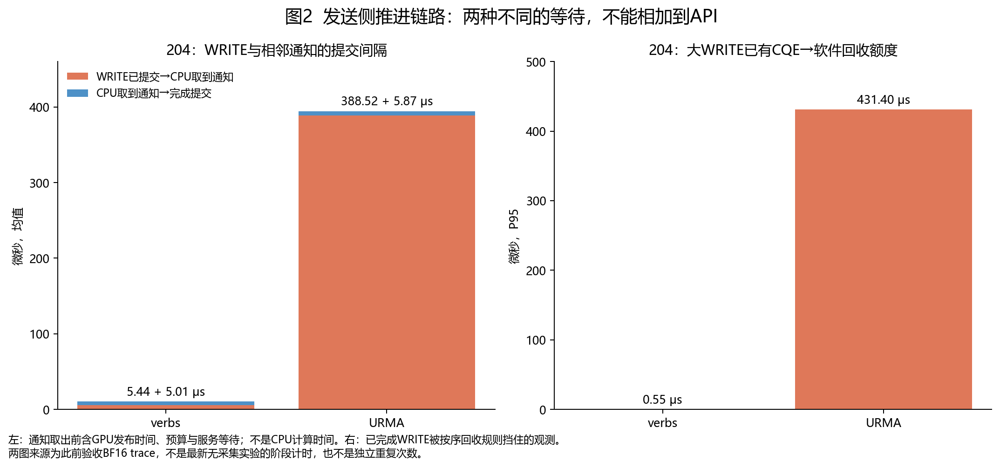
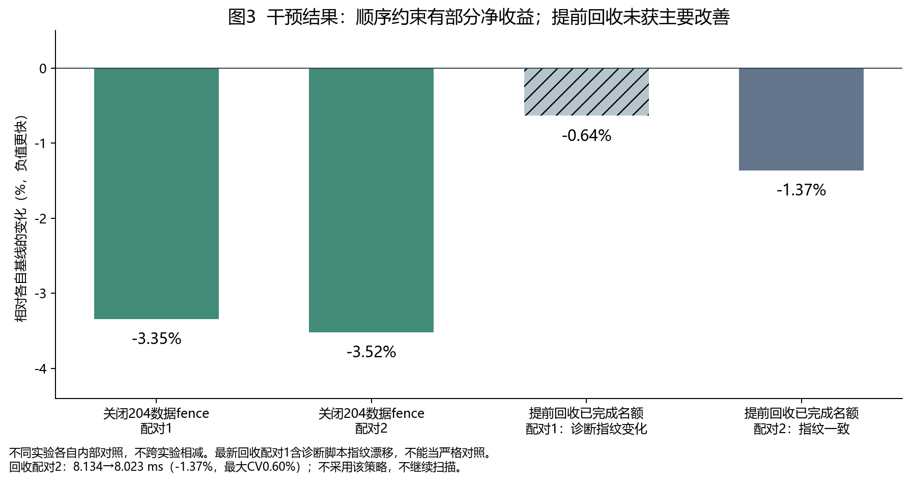

# UCCL-EP URMA Normal Dispatch阶段性总结

日期：2026-11-16。最新输入：b7c32dd6（urma_retire_01）。范围：两节点各一张MetaX C500，Normal BF16，4096 tokens、hidden7168、experts256、topk8、SM24、Dispatch chunk32。verbs与URMA各自使用适用的内核、设备及SDK；两后端对照不是“只换软件API”。

## 可用于汇报的核心结论

**目前已将较大的候选差异收窄到首次WRITE后的持续通信、通知与完成推进链路。URMA在该链路存在ATOMIC完成未观测、FIFO额度满、后续命令晚读取的直接记录；fence放宽有约3.4%的有限净收益。最新“提前回收已完成请求”实验未取得主要净收益，因此不能再把软件按序回收本身当成已经证实的主要可修复根因。**

我们还没有获得完整、可相加的真实关键路径分解，也没有证明全部差距来自某个单独硬件操作。本报告将总耗时、同窗观测覆盖、请求区间和干预结果分别表达。

## 一、整体问题和Dispatch柱状分解


左图是历史关闭采集的匹配基线，整调用均值：

| 节点 | verbs | URMA | URMA变化 |
| --- | ---: | ---: | ---: |
| 202 | 7.14874ms | 8.11395ms | +0.96521ms / +13.50% |
| 204 | 6.82638ms | 6.70259ms | -0.12379ms / -1.81% |

明显回退首先出现在202；204仍需检查，因为204的发送进度影响202接收。不能只看202 CPU或把两端耗时相加。

右图按用户需要，用一根大柱表示整次Dispatch，内部以颜色标出**部分观测覆盖**。使用此前已验收的匹配trace，每窗口先计算、再对9个有效窗口取均值：

| 节点/后端 | 首token→首次WRITE包络 | 首次WRITE→最后远端token可见包络 | 未覆盖余量 | 同窗trace API总量 |
| --- | ---: | ---: | ---: | ---: |
| 202 verbs | 0.40117ms | 6.38910ms | 0.45749ms | 7.24776ms |
| 202 URMA | 0.42152ms | 7.11029ms | 0.62652ms | 8.15832ms |
| 204 verbs | 0.45187ms | 6.02027ms | 0.45786ms | 6.93001ms |
| 204 URMA | 0.44526ms | 5.52855ms | 0.75543ms | 6.72924ms |

定义与限制：

1. 每窗口t0=12个Sender首token记录的最早host_ns，t1=最早首次远端WRITE，t2=最后远端token可见的最晚记录。蓝色=(t1-t0)，橙色=(t2-t1)。
2. 灰色=该窗口API计时−蓝色−橙色，再逐项求均值。全部36个窗口均非负。它是未覆盖的算术余量，**没有被单独打点**，不能称为独立“GPU计算”或“收尾”阶段；真实位置可在观测前后，灰色在柱顶仅为展示。
3. 事件由采样RAW主机时钟估计，API来自同次CUDA事件计时，存在跨计时域采样误差。图示为观测覆盖关系，不是完整精确关键路径。橙色同时覆盖并行的数据准备、CPU排队、设备传输、通知及接收推进，不等于纯网络时间。
4. 不能把左图未采集总时延作为右图trace分母，也不能把不同角色/不同请求的中位数拼成此柱。图中的均值与早期报告6.428/7.110ms等中位数不同，原始统计口径分别保留。

由这一级数据可说：202首批准备覆盖差别约20μs，而首次WRITE后的可见性包络差别更大。不能用某个包络差除以API差，宣布已经解释了多少百分比的回退。

数据：[同窗逐样本](coverage_samples.csv)、[均值](coverage_means.csv)、[历史整体对比](../backend_matched_comparison_01/api_comparison.csv)。

## 二、进一步定位到了哪里


### 2.1 CPU读出后的处理不是当前毫秒级候选差异的主要来源

204已有请求对的均值拆分如下，同一行可以相加：

| 后端/记录组 | WRITE提交结束→CPU取到相邻FADD | CPU取到FADD→提交结束 | 合计 |
| --- | ---: | ---: | ---: |
| verbs历史匹配 | 5.44μs | 5.01μs | 10.45μs |
| URMA已验收boundary | 388.52μs | 5.87μs | 394.39μs |

URMA差异主要位于CPU取到通知之前。这里含GPU命令发布时间、FIFO预算/排队及CPU服务间隔，不直接等于CPU计算或硬件atomic耗时。



### 2.2 已观察到的阻塞形态是完成推进与额度回收背压

在此前已验收URMA BF16边界采集中：

| 末块发布后→CPU取到末块命令 | 202 | 204 |
| --- | ---: | ---: |
| 间隔中位数 | 1.922ms | 3.578ms |
| FIFO额度占满时间占比中位数 | 99.554% | 99.662% |
| 额度满且队首ATOMIC尚无CQE观测的占比中位数 | 99.472% | 99.590% |

这证明观测区间中有真实的完成推进/预算阻塞。它不证明全部间隔都由软件回收规则造成，也不表明接收GPU在整个区间都空等。

同组204的相邻WRITE/FADD完成观测间隔中位数约632.55μs，verbs约4.18μs。FADD已在WRITE完成观测前提交；但提交本身有时差，所以这个间隔不是单个硬件FADD执行时延。

接收GPU在tail已更新且epoch有效后即可消费本批，不要求发送端CPU先收到CQE；发送端CQE迟到仍可通过额度占用拖慢下一批命令。图4区分了这两条路径。

### 2.3 按序回收是一个放大器候选，最新干预没有主要净收益

旧代码两版共享相同逻辑：队首没有完成时，后面已完成的请求也暂不回收。软件已经观察到CQE后，URMA ATOMIC通常0.285μs就回收，但部分大WRITE受前序未完成请求阻挡，204 P95达到431.40μs、202达到603.27μs。

本轮直接让204提前释放这些已确认完成的普通条目额度，保留未完成项、quiet/barrier、FADD强序/fence、窗口数值8和GPU算法。**结果没有出现预期的主要净收益**，见下一节。因此不能仅凭“等待很长”，就把这部分等待当作可全部消除的关键路径贡献。

数据：[FIFO重放](../urma_boundaries_01_fifo_audit/fifo_medians.csv)、[通知对审查](../notify_completion_audit_01/notify_pair_summary.csv)、[通知提交拆分](../notify_submission_audit_01/submission_summary.csv)、[完成后回收等待](../normal_retire_evidence_20261116/software_retire_wait.csv)。这些是不同区间、不同聚合，不相加到API。

## 三、最新实验urma_retire_01分析

### 3.1 运行与配置

128-token门禁及4项正式任务，两端rc=0、checks均为true。实际Proxy日志A两端ordered；B仅204 ready；limit=8。FADD tail/head均实际记录fence=on、order=strong。两端各项均使用同一模块f2bc748b30…及本端同一boot，benchmark normal.py内容一致。

本次运行环境改为非root，运行时权限检查逻辑及角色日志验收有修改。我们保留这些上传修改，不把本地模拟当作真实GPU验证，也不将“无法读取debugfs”解释成设备健康已全面检查。

### 3.2 BF16结果及数据完整性

| 配对 | A按序回收 | B仅204提前回收 | 改善 | 最大CV | 诊断指纹 |
| --- | ---: | ---: | ---: | ---: | --- |
| r01 A→B | 8.04130ms | 7.99016ms | 0.636% / 51.14μs | 1.734% | **改变，仅作有限参考** |
| r02 B→A | 8.13397ms | 8.02290ms | 1.366% / 111.08μs | 0.597% | 一致，可用于该配对判断 |

第一项A的diagnostics_hash=e345300309…，后续三项为2ce1fbf69f…。尽管模块、benchmark、库和boot相同，仍不能认定第一配对满足全部预定身份约束。上传汇总器曾删除benchmark_sha及diagnostics校验；本报告恢复benchmark严格校验和默认诊断严格校验，仅通过显式review参数导出漂移受限结果，并在每一配对标注。

因此不是“已经完成两组严格阴性实验”，而是：**没有获得采用该策略的主要净收益证据，且唯一指纹一致的配对只有约1.37%改善，低于3%的小效应界限。**保留ordered，不采用ready，不要求为补齐第一配对重跑，也不继续换窗口/节点扫描。

FP8第一配对最大CV达18.78%，不能把-6.13%宣称为稳定收益；第二配对为-0.92%。Combine12/16变化约+0.28%～+0.75%，没有优化收益；layout波动较大。主结论以BF16为限。



### 3.3 这个阴性结果排除了什么

它削弱了“只要及时释放已完成WRITE的额度，就能明显解决204→202 Normal BF16回退”这个候选。它没有否定FIFO背压的存在，也没有证明所有回收优化都无效；更没有直接测出剩余设备/远端等待的组成。

可能的解释包括：关键限制仍是尚未完成的ATOMIC，提前释放其他名额不足以改变关键路径，或新请求只把等待移到设备侧。这些是对阴性结果的解释候选，不是本轮已测得的原因。

原数据：[上传汇总](../urma_retire_01_summary/rounds.csv)；经身份审查的[配对结果](../urma_retire_01_review_20261116/rounds.csv)、[受限判定](../urma_retire_01_review_20261116/decision.csv)、[指纹记录](../urma_retire_01_review_20261116/context.json)。

## 四、为什么URMA明显而RDMA没有同程度表现

准确表述是：**两版都有队首顺序回收规则；在已测负载中，verbs没有出现同程度的通知提交/完成间隔和完成后回收长尾。**不能说RDMA架构上没有这个问题。

| 层次 | 已知差异或共同点 | 当前证据支持什么 |
| --- | --- | --- |
| GPU算法、FIFO预算/队首规则 | 主要结构相同，默认数值8 | 排队机制不是URMA独有；尚未证明是单独的软件bug |
| FADD请求约束 | URMA STRONG并默认fence；verbs Native FADD显式设置SIGNALED、未设置SEND_FENCE | 存在值得检验的实现差异，但两API隐含保证不相同 |
| 顺序约束干预 | 仅204数据FADD去fence，严格ABBA改善3.35%/3.52%，后续关闭采集又出现约3.48%幅度 | 该约束有部分净性能代价，是目前较强的干预证据；尚非全量解决方案 |
| 完成推进 | URMA成对软件CQE观测间隔较长 | 可以定位到推进链路，不能单凭软件时间拆成设备执行、远端访问、返回或轮询成本 |
| 软件提前回收 | 本轮没有主要净收益 | 不把“已完成WRITE被挡住”继续当作已证实的主要修复点 |
| 内核/设备/SDK | 两后端不同 | 尚不能宣称剩余差距只由URMA API或某个标志导致 |

公开URMA API将fence与place_order/comp_order分别定义，fence涉及前序READ/ATOMIC依赖；不只是“等对应WRITE”的同义词。[openEuler URMA API](https://docs.openeuler.org/zh/docs/24.03_LTS_SP3/unifiedbus/unifiedbus/urma/URMA%20API%20Guide.ch.html)。当前私有SDK/硬件的实际依赖范围、远端GPU原子访问及完成推进仍需进一步审查。

较直观的机制假设是：URMA当前约束/后端推进使ATOMIC更迟满足完成条件，共同的FIFO预算规则再把这种迟滞传导给后续命令。顺序约束的部分收益已有证据；整条链的独占关键路径及底层源头仍未完全闭合。不能把0.965ms全部分配给fence或CPU Proxy。

## 五、目前如何处理，哪些方案不应采用

| 措施 | 当前处理 |
| --- | --- |
| Normal WRITE使用RELAX | 保留；历史单变量实验显示STRONG显著更慢，当前回退基线已是RELAX |
| 关闭204数据FADD fence | 保留为约3.4%的诊断候选；尚未完成跨形状/长期复用及依赖语义验证，不自动修改生产默认 |
| 提前回收已完成请求额度 | 本轮不采用，默认ordered；没有主要收益，不再重测该候选 |
| 窗口8改4 | 既有实验没有净收益，保留8，不继续扫描 |
| 密集/稀疏阶段采集反复重测 | 停止旧observe系列；近轮扰动超标，不能依赖它追求精确归因 |
| 把FADD直接改弱序或删除barrier/epoch | 不采用；没有相应正确性及收益证据 |

目前没有一个已经验证可以消除全部Normal回退的修复。工程上应保持已知有效的WRITE设置，将fence有限收益与剩余差距分开处理，并把“改动是否带来真实净收益”作为后续上机的门槛。

下一阶段先做不占机器的代码/私有SDK依赖审查：明确前序ATOMIC为什么约束后续通知、远端原子目标注册及完成路径有什么可改变差异。只在有具体可干预点、正确性边界和明确正负判定时再上机。已有tail/head三配置代码仍是一个中优先级、缩小fence收益作用范围的候选，不将它包装成一定能解决主要回退的实验。本报告不新增GPU任务或要求补跑第一配对。

## 六、可直接用于汇报的表述

> Normal BF16的URMA回退主要候选区间已收窄到首次WRITE后的持续通信、通知与完成推进链路。我们观察到ATOMIC完成未被CPU观测时，FIFO预算长期占满、后续命令晚读取；verbs同程度现象较弱。去掉204数据FADD的额外fence约束取得约3.4%的部分净收益。最新提前回收已完成请求的实验只有约1%的小改善，未支持将该软件回收规则作为主要修复点。剩余差距尚未全部归因，目前没有证据把它概括为CPU算力不足、GPU计算慢或纯带宽不足。

## 七、复现与材料

图均提供PNG和SVG；PNG可直接用于汇报，SVG便于缩放。生成脚本：tools/reference_events/build_normal_progress_report.py。运行：

```bash
python3 tools/reference_events/build_normal_progress_report.py \
  --root test/reference_events/results \
  --output test/reference_events/results/normal_progress_20261116
```

figure_sources.json记录图表源文件SHA；coverage_samples.csv保留同窗拆分，coverage_means.csv保留均值。图形生成不运行benchmark，不合成测量值。

最新回收数据的严格汇总默认会拒绝诊断漂移；仅用于审查的显式导出命令如下（输出为新目录）：

```bash
python3 tools/reference_events/summarize_retire.py \
  --root test/reference_events/results --job urma_retire_01 \
  --output /tmp/urma_retire_review_new --allow-diagnostic-drift
```

该参数只允许带警告审查诊断指纹漂移，仍要求benchmark内容及其他身份一致，并将受影响配对判定为受限；不能用它宣称严格A/B通过。
