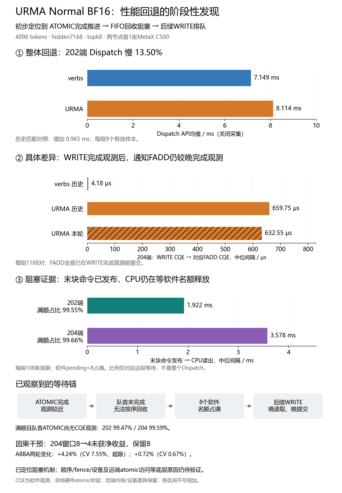

# URMA Normal BF16性能回退：汇报图与建议表述

讲定位过程时，请先使用[八步证据递进版](../normal_evidence_steps_20261112/README.zh-CN.md)，逐步说明数据、判断和下一步理由。本页一页总览放在最后作结论页，不替代中间的验证过程。

排序与通知的详细解释、强弱序A/B结果及当前结论边界，见[排序/通知专题报告](../normal_order_notify_review_20261112/README.zh-CN.md)。

## 可直接使用的图

- [一页汇报总览 PNG](01-report-overview.png) / [矢量SVG](01-report-overview.svg)：整体回退、通知完成间隔、FIFO阻塞机制及窗口干预结果。
- [两端通知完成对照 PNG](02-notify-detail.png) / [矢量SVG](02-notify-detail.svg)：区分历史匹配对照与本轮URMA复现，显示两端数据。

## 建议汇报表述

在4096-token Normal BF16匹配对照中，202端URMA Dispatch为8.114ms，verbs为7.149ms，回退约13.5%。目前已将调查重点收窄到通知ATOMIC的完成推进：204端WRITE完成观测到对应通知FADD完成观测的中位间隔，verbs约4.18μs、URMA约659.75μs，本轮URMA复现为632.55μs，所有通知均已提前提交。结合FIFO事件重放，末块命令发布后约3.578ms才被CPU取出，其中99%以上时间8个软件名额占满、队首主要是尚未观察到完成的ATOMIC。初步定位的阻塞机制是ATOMIC完成推进较迟，经按序回收约束阻塞后续WRITE；尚未唯一确定顺序/fence、设备队列或远端atomic访问等底层原因。

## 四项汇报要点

| 要点 | 数据 | 可支持的结论 |
| --- | --- | --- |
| 整体回退 | 历史202 BF16 7.149→8.114ms，+0.965ms/+13.50% | 明确需要解释的整体差额 |
| 通知完成推进 | 204成对CQE间隔4.18→659.75μs，本轮632.55μs；每组1188对 | 通知FADD提交后的推进是具体差异位置；非纯硬件atomic时延 |
| 后续命令阻塞 | 本轮204末块发布→CPU读取3.578ms；满额比例中位99.66%，满额且队首ATOMIC尚无CQE观测99.59% | 已观察到软件FIFO按序回收/额度约束形成的阻塞机制 |
| 窗口干预 | 204窗口8→4，ABBA两轮+4.24%（CV7.55%，超限）、+0.72%（CV0.67%） | 未取得净收益，保留8；窗口过大不是已确认根因 |

## 统计口径与边界

- 共同形状：4096 tokens、hidden7168、experts256、topk8，SM24、Dispatch chunk32、NVL chunk4；两节点各一张C500。历史后端内核、设备及SDK不同，此混杂因素保留。
- 整体时延为9个有效API样本均值，阶段和成对请求主要为中位数。每节点/采集组1188对WRITE/FADD，FIFO数据每端9窗口×12通道=108条，均不是大量独立campaign复测。
- 每组1188对FADD均已在对应WRITE完成观测之前提交；配对要求同Proxy/ring、相邻命令、同endpoint、payload字节与通知token数一致。
- CQE均是软件观测，两个CQE的间隔不等于硬件atomic单操作耗时。WRITE CQE也不测远端GPU何时实际观察到payload或tail。
- FIFO满额比例仅针对末块发布→CPU读取区间，不是整个Dispatch的占比；8是软件未回收命令额度，不是硬件SQ深度。
- 新增边界BF16采集相对前后控制均值影响202 +2.60%、204 +4.38%，通过原5%门槛；FP8未通过，不用于本图归因。
- 各区间跨角色、并行且统计口径不同，不相加为完整关键路径，不将3.578ms全部解释成URMA相对verbs的净损失。

## 数据出处

- [历史整体对照](../backend_matched_comparison_01/api_comparison.csv)
- [通知成对完成统计](../notify_completion_audit_01/notify_pair_summary.csv)及[完整配对方法](../notify_completion_audit_01/ANALYSIS.zh-CN.md)
- [FIFO重放统计](../urma_boundaries_01_fifo_audit/fifo_medians.csv)及[具体阻塞证据](../urma_boundaries_01_fifo_audit/ANALYSIS.zh-CN.md)
- [窗口ABBA结果](../urma_window_after_boundaries_01_summary/ANALYSIS.zh-CN.md)

图表均读取上述CSV，不生成合成实验数据。figure_sources.json保留输入SHA256。复绘使用tools/reference_events/plot_regression_brief.py，显式指定新输出目录；Linux需--font指定中文字体。不启动GPU测试。
