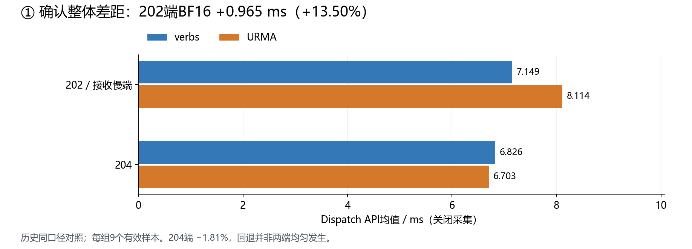
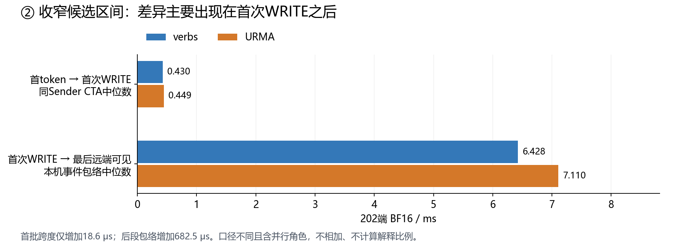
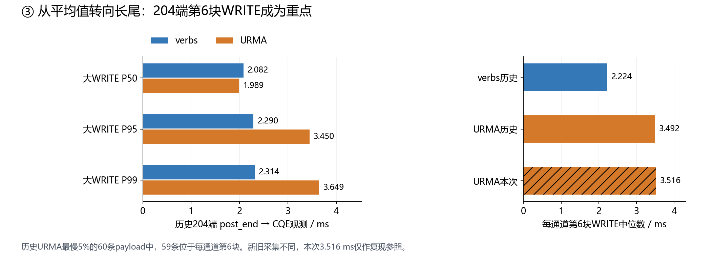
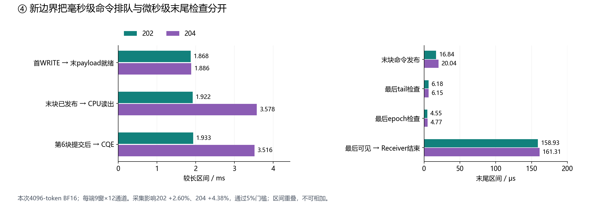
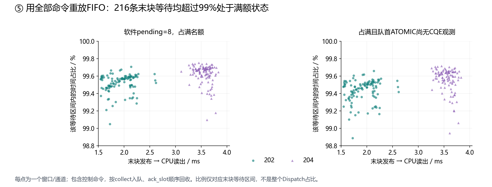
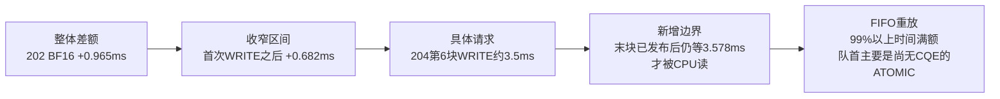

# Normal性能定位阶段小结：从整体回退到ATOMIC完成推进与FIFO阻塞

截至2026-11-12。本小结沿最近一次同口径Normal BF16证据链整理，不把更早不同形状、调优参数、采样方式的数据拼接成趋势。

**目前已直接观察到：URMA当前路径中，前面ATOMIC的完成观测较迟，FIFO无法按序回收，8个软件名额长期占满，后续WRITE在CPU读取前排队毫秒级。尚未证明全部URMA-vs-verbs差额来自该机制，也未唯一确定ATOMIC推进变慢的设备/顺序/访问原因。**

## 共同测试口径

Normal、4096 tokens、hidden7168、experts256、topk8，SM24、Dispatch chunk32、NVL chunk4；202/master和204/worker1各一张MetaX C500 GPU0。Torch 2.6.0+metax3.7.0.7，记录的MACA 3.9.0.29/KMD 3.10.14及libmcruntime.so摘要一致。

verbs使用oe2403sp3内核、rocep40s0f0/GID3/DMA-BUF；URMA使用gdr诊断内核、udmac0d1e2，Normal WRITE RELAX、FADD强序/fence、completion all、lane-mixed。内核、设备和SDK差异仍是混杂因素，不能称为同机同内核只换一个软件开关的对照。

每组5次预热、10次采样、按计划丢首值后9个有效样本。请求/通道统计包含同一次运行中的相关观测，不当作大量独立复测。128-token仅用于检查正确性、ABI、覆盖，不能替代4096-token生产形状。

## 第一步：先确认整体差距，决定优先研究哪个负载和方向

以关闭采集的历史匹配paced对照为准，单位ms，为9个有效API样本均值：

| 节点 | BF16 verbs | BF16 URMA | URMA−verbs | 相对变化 |
| --- | ---: | ---: | ---: | ---: |
| 202 | 7.149 | 8.114 | +0.965 | **+13.50%** |
| 204 | 6.826 | 6.703 | −0.124 | −1.81% |

FP8差距约202 +4.17%、204 +2.76%，明显小于202 BF16；Combine的paced小幅变慢与on小幅变快方向不一致，尚不作为稳定回退。因此优先选202 BF16，并同时观察向它发送数据的204侧。

**这一步得到：** 确实存在需要解释的202 BF16近1ms差额；不是所有节点、所有负载均匀退化。此时还不知道CPU、GPU、排队或传输哪个环节负责。



数据：[api_comparison.csv](../backend_matched_comparison_01/api_comparison.csv)。这只是同口径campaign的样本均值，不是跨多次独立campaign的稳定置信区间。

## 第二步：用三个稀疏GPU事件，把候选区间收窄到首次WRITE之后

202 BF16，单位ms：

| 观察区间 | verbs | URMA | 增量 |
| --- | ---: | ---: | ---: |
| 首token→首次WRITE，同Sender CTA中位跨度 | 0.430 | 0.449 | **0.019** |
| 首次WRITE→最后远端token可见，本机事件包络中位数 | 6.428 | 7.110 | **0.682** |

首批发送前的差别只有约19μs，较大的差别出现在首次WRITE之后。这支持把注意力转向持续发送、提交后依赖、通知、可见性推进，而非只调查首批准备。

**这一步得到：** 明确了需要进一步拆解的长区间；仍不能直接将它命名为CPU Proxy计算、网络传输或GPU纯计算。



数据：[gpu_span_comparison.csv](../backend_matched_comparison_01/gpu_span_comparison.csv)。前后两个口径不同、角色并行、各自取中位数，不能相加，也不能用0.682/0.965声称已解释某个百分比的整体回退。

## 第三步：把CPU请求按种类、分位数和序号拆开，找到204第6块WRITE

先前完整业务链中，204 BF16的decoded→prepare仅约3.02→3.22μs，SDK调用约0.70→0.75μs，难以直接解释近1ms整体差额。但不能只看请求中位数，因为真正异常集中在尾部。

204 BF16大payload WRITE，post_end→软件观测最后CQE，单位ms：

| 分布 | verbs | URMA |
| --- | ---: | ---: |
| P50 | 2.082 | 1.989 |
| P95 | **2.290** | **3.450** |
| P99 | **2.314** | **3.649** |

URMA的请求P50反而较短，P95/P99却明显更长。进一步按每个Proxy/ring/window的大WRITE顺序审查：

- 204 URMA最慢5%的60条payload中，**59条位于每通道第6块**。
- 该位置108条请求中位数：verbs **2.224ms**，历史URMA **3.492ms**。
- 本轮新增边界测试的同位置URMA为 **3.516ms**，复现了约3.5ms长尾；这是跨campaign参照，不将新采集冒充旧verbs新增点的配对对照。

**这一步得到：** “第6块大WRITE及其前序命令依赖”有了具体数据依据；后续加第6块打点来自这里，不是随意选一个序号。



数据：[cpu_completion_tails.csv](../backend_matched_comparison_01/cpu_completion_tails.csv)、[payload_positions.csv](../window_audit_01/payload_positions.csv)、[window_audit上下文](../window_audit_01/context.json)、[本轮cpu_chunk6_and_last.csv](../urma_boundaries_01_summary/cpu_chunk6_and_last.csv)。历史每端/负载9窗×132大WRITE=1188条；特定序号为9窗×12通道=108条。

### 中间的一次方向修正：混合提交没有得到优先归因支持

源码中URMA与verbs存在提交分组差异，但“存在差异”不等于“导致回退”。同为459264B的204 BF16 WRITE：

| URMA观察分组 | 请求数 | P95 ms |
| --- | ---: | ---: |
| 非混合提交 | 527 | **3.601** |
| 混合提交 | 553 | **2.952** |

混合组的长尾没有更差，不能据此优先认定混合提交有害，所以暂停了这个A/B。观察分组不是随机受控实验，也不能反向宣布混合提交更优。详见[混合提交证据复核](../SUBMISSION_MIX_EVIDENCE.zh-CN.md)。

## 第四步：新增稀疏边界，并用前后关闭采集对照检查扰动

新增末块及第6块WRITE准备/发布、末块tail检查、末token epoch检查、Forwarder及Receiver完成点；同时保留CPU完整请求链及每128次SDK轮询的心跳。

4096-token BF16三项控制结果，单位ms：

| 节点 | paced关闭 | trace开启 | post关闭 | trace相对两控制均值 | 最大CV |
| --- | ---: | ---: | ---: | ---: | ---: |
| 202 | 8.041 | 8.255 | 8.050 | **+2.60%** | 0.474% |
| 204 | 6.675 | 6.927 | 6.598 | **+4.38%** | 0.743% |

BF16均通过原5%工程门槛，零丢记录。FP8 post相对paced漂移202 +11.85%、204 +16.12%，不通过，所以只对BF16进行后续正式解释。全局summary的usable=false来自“全部Dispatch均通过”要求，不等于BF16也失败；没有放宽门槛。

新增边界中位数：

| BF16区间 | 202 | 204 |
| --- | ---: | ---: |
| 首WRITE→末payload就绪 | 1.868ms | 1.886ms |
| 末块命令发布函数及通知 | 16.84μs | 20.04μs |
| 末块已发布→CPU读出 | **1.922ms** | **3.578ms** |
| 第6块post_end→软件CQE观测 | **1.933ms** | **3.516ms** |
| 最后一次tail检查 | 6.18μs | 6.15μs |
| 最后token epoch检查 | 4.55μs | 4.77μs |
| 最后远端可见→Receiver完成 | 158.93μs | 161.31μs |

最后块被CPU读到后，decoded→prepare约3.00/3.17μs，prepare→post_begin约0.86/0.88μs；毫秒级延迟发生在更早的“GPU已发布、CPU尚未读”区间及提交后完成推进，而非命令读出后的几微秒处理。

**这一步得到：** 抓到可以继续解释的具体间隔：204发送端末块已发布后，仍约3.58ms才被CPU读取。末块tail/epoch检查在这批正式负载里没有同等级别长等待。



数据：[api_controls.csv](../urma_boundaries_01_summary/api_controls.csv)、[boundary_medians.csv](../urma_boundaries_01_summary/boundary_medians.csv)、[cpu_chunk6_and_last.csv](../urma_boundaries_01_summary/cpu_chunk6_and_last.csv)、[last_write_fifo.csv](../urma_boundaries_01_fifo_audit/last_write_fifo.csv)。不同角色/请求的区间重叠，图中不做堆叠，也不相加。

### 第二次方向修正：128-token线索不能推广到4096-token

128-token smoke末块tail总跨度中位数202/204为331.52/291.21μs，正式4096-token只有约6.18/6.15μs。因此以正式负载为准，不继续声称“最后一次tail自旋”是主瓶颈。这是形状改变，不是优化带来的时延下降。

短区间包含观察器开销；128-token首条和末条是同一条WRITE，代码相邻的E1/E3也读到约13μs，所以不能把几μs读数当成精准无打点等待，更不能机械扣一个固定常数。此次验收只表示整体扰动在工程门槛内，不证明所有内部阶段零扰动。

## 第五步：用现有日志重放全部FIFO命令，解释CPU为什么晚读

这一步没有新增实机测试。对每个Proxy/ring，按照collect纳入pending、ack_slot移出队首，重放包括QUIET/BARRIER在内的全部命令。拒绝重复/缺失入队、越序回收、超过8、窗口结束未回收或区间不完整的情况。

对每条“末块发布→CPU读出”间隔积分：

| BF16观察，逐通道比例的中位数 | 202 | 204 |
| --- | ---: | ---: |
| 队列8个未回收名额占满的时间比例 | **99.554%** | **99.662%** |
| 满额且队首为ATOMIC | **99.554%** | **99.656%** |
| 满额且队首ATOMIC尚无CQE观测 | **99.472%** | **99.590%** |
| 108条观察中的最低占满比例 | 99.049% | 99.097% |

两端216条观察，在GPU发布时pending全部为8；所有观察的满额覆盖比例都超过99%。它不是某一条离群请求造成的现象。



源码与记录相互吻合：

1. `notify_gpu_completion()` 只能按FIFO顺序回收，队首未完成便停止；后面WRITE即使已有CQE，也不能越过它释放名额。
2. `post_gpu_command()` 使用 `budget=max(8-pending,0)`，pending=8时根本不会继续poll下一个FIFO命令。
3. Proxy循环先轮询完成、再回收、再读取新命令。

还有直接的越序完成例子：204 BF16 index1、Proxy0/ring0，WRITE wr4102在5.949ms已观测CQE，但前面的ATOMIC wr4101到6.262ms才完成，WRITE因而到6.262ms才回收；最后块wr4110到6.264ms才被CPU读出。所有时间相对同一端CPU origin，不跨机器相减。

**这一步得到：** 已用事件记录解释当前停顿机制：ATOMIC完成推进较迟→FIFO按序回收受阻→软件8个名额占满→后续WRITE在CPU读取前排队。这里的8是软件未回收命令数，包括WRITE/ATOMIC，不是硬件SQ深度或8条纯WRITE。

数据及详细例子：[FIFO重建分析](../urma_boundaries_01_fifo_audit/ANALYSIS.zh-CN.md)、[216条逐通道记录](../urma_boundaries_01_fifo_audit/last_write_fifo.csv)。

## 目前可以汇报到哪一层

| 问题 | 当前证据支持的回答 |
| --- | --- |
| URMA Normal整体是否落后？ | 历史匹配paced的202 BF16慢0.965ms/13.50%，204未见同等回退；不能推广为所有负载。 |
| 大的额外候选区间在哪里？ | 首次WRITE之后的持续推进；204第6块WRITE提交后长尾明显。 |
| 最新记录具体看到了什么阻塞？ | GPU已发布的后续命令，因前面ATOMIC完成观测迟、FIFO满额及按序回收而晚被CPU读取。 |
| 是CPU纯计算慢吗？ | 命令读出后的准备仅数μs；不支持它解释已观测的毫秒级排队。 |
| 是最后一次tail/epoch检查慢吗？ | 正式4096-token该检查约4～6μs，不是这批已测部分中最大的等待。 |
| 能认定是线速传输或URMA硬件atomic本身慢吗？ | 还不能。post→CQE混有设备队列、依赖、对端访问及软件完成观测。 |
| 能说Proxy整段停止轮询了吗？ | 第6块请求均被心跳完整夹住，最大心跳间隔不超过约0.585ms，不支持整段3.5ms完全未进入SDK轮询；不能证明硬件何时产出CQE。 |
| 能把3.578ms全算成URMA比verbs多出来的吗？ | 不能。新增边界/FIFO机制来自本轮URMA；共享FIFO逻辑在verbs中也存在，新增点还缺verbs对照。 |
| 是否已经确定唯一底层根因？ | 尚未。已定位阻塞机制，仍需区分顺序依赖、并发放大、设备/对端访问等原因。 |

当前证据链可以表示为：



箭头表示调查证据的递进，不代表这些时长可相加，也不代表已建立每个环节对整体差额的独立因果贡献。

## 下一步只验证一个因果问题

**后续进展：该窗口ABBA已经完成。**BF16 r01 B相对A +4.236%但CV超限，r02稳定但+0.719%，未获净收益，保留8、不追加窗口扫描。详见[窗口结果](../urma_window_after_boundaries_01_summary/ANALYSIS.zh-CN.md)。新增纯离线配对审查还发现：WRITE完成观测后，对应FADD完成观测的中位间隔verbs约4μs、URMA约0.55～0.66ms；所有FADD都已在WRITE完成前提交，见[通知完成审查](../notify_completion_audit_01/ANALYSIS.zh-CN.md)。以下保留当时的预定计划，不要求重复执行。

已准备202保持8、204窗口8→4的关闭采集ABBA实验：A→B→B→A。复用当前模块、不重编译、不新增GPU打点、不重跑smoke。操作见[窗口因果测试文档](../../WINDOW_CAUSAL.zh-CN.md)。

目的不是重复确认队列曾满，而是测试：**降低并发是否缩短提交后等待，并带来真实Dispatch净改善？** 减窗也可能让等待前移、降低并行度，因此只有两轮净改善及正确性/CV同时通过才采用。没有结果前不声称它能解决回退，也不将8→4阴性结果等同于否定FIFO满额事实。

## 图表与复算

五张图均由已提交CSV/JSON绘制，PNG用于预览，SVG可用于汇报排版。figure_sources.json记录每个输入文件SHA256。重绘不需GPU：

```bash
python tools/reference_events/plot_stage_summary.py \
  --output /path/to/new_stage_summary \
  --font /path/to/a/chinese-font.ttf
```

Windows默认使用微软雅黑；Linux显式指定支持中文的字体。输出目录须不存在。不启动设备测试，不生成合成实验数据。
