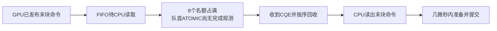

# URMA Normal BF16：已观察到ATOMIC完成推进拖住FIFO读取

后续[窗口ABBA结果](../urma_window_after_boundaries_01_summary/ANALYSIS.zh-CN.md)未支持8→4带来净收益，保留8；不因此否定下述满额等待事实。新增[通知完成配对审查](../notify_completion_audit_01/ANALYSIS.zh-CN.md)进一步将注意力收窄到WRITE完成观测后仍迟到的通知FADD。下文保留本阶段观察及当时提出的干预计划。

输入提交 `08adc33d`，打点实现 `de66ec0f`。4096-token paced、trace、post两端齐全，六个status均rc=0、全部checks=true。独立运行 `summarize_boundaries.py` 复核原始结果，并新增纯离线FIFO所有权重放，无需服务器再测。

**本轮最具体的发现：末payload已经在GPU侧准备并发布，但CPU很晚才读出；这段间隔超过99%的时间，对应FIFO的8个未回收名额被占满，队首主要是尚未观察到完成的ATOMIC。** 不再只是“Dispatch kernel慢”或笼统猜测“CPU Proxy慢”。

## 先区分BF16可用与FP8控制失败

下表单位ms，是丢首值后的9个API样本均值；开启采集变化相对前后两关闭采集均值计算。

| 节点/Dispatch | paced关闭 | trace开启 | post关闭 | 前后漂移 | 采集变化 | 最大CV | 按负载验收 |
| --- | ---: | ---: | ---: | ---: | ---: | ---: | --- |
| 202 BF16 | 8.041 | 8.255 | 8.050 | +0.107% | +2.600% | 0.474% | 通过 |
| 204 BF16 | 6.675 | 6.927 | 6.598 | −1.148% | +4.378% | 0.743% | 通过 |
| 202 FP8 | 5.837 | 5.929 | 6.529 | +11.854% | −4.099% | 16.288% | 未通过 |
| 204 FP8 | 5.866 | 5.894 | 6.811 | +16.118% | −7.008% | 18.894% | 未通过 |

上传的全局summary标usable=false，原因是它要求全部Dispatch测点均通过。**这不等于BF16也失败。** 本分析仅使用两端均通过原5%性能门槛、时钟偏移检查及覆盖检查的BF16，不放宽阈值、不删除FP8异常样本。新增离线审查工具按负载验收，只接纳dispatch_bf16_chunk32。

BF16每端9个采集窗口，每窗12通道；每项阶段或特定WRITE位置共108条通道观测，不将它们当108次独立benchmark。主机时钟未早于CPU窗口origin，scheduler_error=0，CPU/GPU零丢记录。每通道11条大WRITE，第6及最后一条按通道和发布顺序关联，不是协议中新增的WR标识。

## GPU边界：最后一次tail/epoch检查没有毫秒级等待

单位μs，108条通道观测的中位数。

| BF16区间 | 202 | 204 |
| --- | ---: | ---: |
| 首次WRITE调用前→最后payload就绪 E1→E3 | 1868.47 | 1886.36 |
| 第6块WRITE及对应通知发布 E10→E11 | 26.82 | 32.20 |
| 最后WRITE及对应通知发布 E3→E4 | 16.84 | 20.04 |
| 末块tail检查 首E5→E6 | 6.18 | 6.15 |
| 最后token epoch检查 E7→E2 | 4.55 | 4.77 |
| 最后远端token可见→Forwarder完成 E2→E8 | 9.79 | 10.14 |
| 最后远端token可见→Receiver完成 E2→E9 | 158.93 | 161.31 |

**128-token smoke中的末块tail长跨度没有延续到4096-token正式负载。** 正式测试不能继续据smoke约0.3ms的tail跨度认定“最后一次tail spin”是瓶颈。短区间包含读钟和记录开销，数μs不等于真实无打点等待；但这些末尾检查没有表现出与后文1～3ms命令排队相同量级的延迟。

这里并未覆盖所有中间chunk的等待，也没有直接测出GPU纯计算时间。最后检查很短，不排除更早的数据、通知或反馈推进拖延。各角色重叠，不将表中跨度相加成完整关键路径。

## GPU已发命令，CPU仍未读出

单位μs，均为108条请求的中位数。

| BF16位置/区间 | 202发送端 | 204发送端 |
| --- | ---: | ---: |
| 第6块GPU就绪→CPU读到命令 | 36.64 | 406.58 |
| 第6块post_end→软件观测CQE | 1932.96 | 3516.10 |
| 最后块GPU就绪→CPU读到命令 | 1939.81 | 3599.56 |
| 最后块GPU发布数据及tail后→CPU读到命令 | **1922.03** | **3578.27** |
| 最后块CPU decoded→prepare | 3.00 | 3.17 |
| 最后块prepare→post_begin | 0.86 | 0.88 |
| 最后块SDK post_begin→post_end | 0.50 | 0.54 |
| 最后块post_end→软件观测CQE | 1175.58 | 973.41 |

“CPU读到以后算得慢”无法解释这里几毫秒的等待：真正大的延迟发生在CPU读取之前，以及提交后的完成观测期间。204发送到202，方向上与202整体BF16较慢一致；没有跨主机相减时间戳，也没有把发送端某个CQE等同接收端某个可见性事件。

## 用实际入队/回收事件重建等待原因

按每个Proxy/ring，collect将WR纳入软件pending，ack_slot将队首WR移出。全部命令均重放，包括QUIET/BARRIER等本地控制命令，不只看有网络CQE的业务链。工具要求：无重复/缺失collect、无越序回收、pending不超8、窗口结束全部回收、目标观察区间完整覆盖，否则直接拒绝。

对每通道“最后块E4发布后→CPU poll该WRITE”区间逐段积分，得到：

| BF16观察 | 202 | 204 |
| --- | ---: | ---: |
| 间隔中位数 | 1.922ms | 3.578ms |
| 每条观察中名额占满比例的中位数 | **99.554%** | **99.662%** |
| 名额占满且队首为ATOMIC的时间占比中位数 | **99.554%** | **99.656%** |
| 名额占满且队首ATOMIC尚未观察到CQE的占比中位数 | **99.472%** | **99.590%** |
| 所有108条观察中，最低占满比例 | 99.049% | 99.097% |
| GPU发布时软件pending数量 | 全部8 | 全部8 |

这不是硬件SQ深度，而是 `fifo_pending_` 的软件额度。说明长间隔主要在等待前面ATOMIC的完成推进，随后名额释放才允许继续读取FIFO；不只是已完成ATOMIC在CPU回收代码里处理了几毫秒。

对应源码机制位于 `ep/src/proxy.cpp`：

1. `notify_gpu_completion()` 按FIFO顺序回收，队首没有完成即停止；即使后面的WRITE已观察到CQE，也不能越过队首回收。
2. `post_gpu_command()` 取pending队列长度，`budget=max(8-pending,0)`；满8时，连下一个FIFO命令都不会poll。
3. 同一Proxy循环先轮询完成，再回收，再读取新命令。



### 一条原始例子

204 BF16、index=1、Proxy0/ring0。时间均相对本端CPU采集origin，不跨机比较：

| 请求 | post_end μs | CQE μs | ack_slot μs |
| --- | ---: | ---: | ---: |
| ATOMIC wr4099 | 2191.01 | 5901.18 | 5901.41 |
| 第6条payload WRITE wr4100 | 2342.66 | 5901.26 | 5901.50 |
| 后续payload WRITE wr4102 | 2977.58 | 5948.98 | 6262.17 |
| ATOMIC wr4101（FIFO中在4102前） | 2977.74 | 6261.76 | 6262.01 |

wr4102虽在5948.98μs已观察到CQE，仍等前面的wr4101到6261.76μs才允许按序回收。最后一条payload wr4110在6263.97μs才被CPU读出，6267.67μs开始提交。逐窗/通道积分结果见last_write_fifo.csv，不靠这一条例子代替全体数据。

## 心跳与历史verbs参考能够补充什么

第6条BF16 WRITE的108/108条请求，两端心跳都完整夹住post→CQE区间。每条请求范围内最大心跳间隔的中位数202为539.33μs、204为516.31μs；所有这些请求的最大值分别584.96/585.38μs。

这不支持“Proxy在整个约3.5ms期间完全没进入SDK轮询”的解释。但心跳不是硬件CQE到达时间，仍不能把post→CQE全解释成线速传输；内部顺序、设备队列、远端显存/atomic访问及软件批量推进都在该口径内。最后块部分请求没有完整心跳夹持，不拿这些请求做同等排除。

历史已验收window_audit_01中，204第6条payload的post_end→CQE中位数verbs为2223.97μs、URMA为3492.48μs；本次URMA为3516.10μs，再现同一位置的约3.5ms长尾。历史verbs没有新增GPU边界，不能伪造本轮同口径的GPU发布→CPU读取差额或满额占比对照。

## 结论的层级与下一步

**已直接观察到的机制：ATOMIC完成推进迟→FIFO按序回收受阻→8个软件额度占满→后续WRITE命令在CPU读取前排队毫秒级。** 末块epoch检查、末块命令发布函数和CPU读到命令后的准备，不是本批已测部分中最大的等待。

**尚未证明的底层原因：** 为什么URMA对应请求的完成推进比历史verbs慢。FIFO额度和按序回收逻辑为两后端共享，不能将它直接称为URMA独有bug，也不能将本批的3.578ms全算成相对verbs的净损失。

静态代码审查还有一个需要约束验证的差异：URMA FADD设置STRONG及fence=true；当前verbs Native FADD构造仅显式设置IBV_SEND_SIGNALED，没有设置IBV_SEND_FENCE。两种API/设备的隐含依赖并不因此相等，不能据字段名称宣布等价或直接删URMA fence。当前不改正确性语义。

下一步只恢复一个已有、低风险的因果实验：**202保持8，204将窗口8→4，关闭采集做ABBA四项。** 目的是判断并发深度是否放大ATOMIC完成等待并拖慢两端真实Dispatch，而不是再次证明队列曾满。无需重编译，不新增GPU打点；完整操作见 `test/reference_events/WINDOW_CAUSAL.zh-CN.md`。

若B两轮均改善≥5%，再决定针对提交后顺序/深度做优化；若变差或无明显改善，说明简单减窗不能解决，保留8，继续审查已明确的ATOMIC提交后路径，不扩大窗口扫描矩阵。该干预不能单独证明所有URMA-vs-verbs差额来自窗口。

## 离线复算

```bash
python3 tools/reference_events/audit_boundary_fifo.py \
  --control test/reference_events/results/urma_boundaries_01_paced \
  --trace test/reference_events/results/urma_boundaries_01_trace \
  --post test/reference_events/results/urma_boundaries_01_post \
  --output /tmp/urma_boundaries_fifo_audit
```

输出目录须不存在。仅按两端均通过控制门槛的负载导出last_write_fifo.csv、fifo_medians.csv和context.json。原始stage表及CPU链在相邻urma_boundaries_01_summary，完整原始窗口在urma_boundaries_01_trace。
