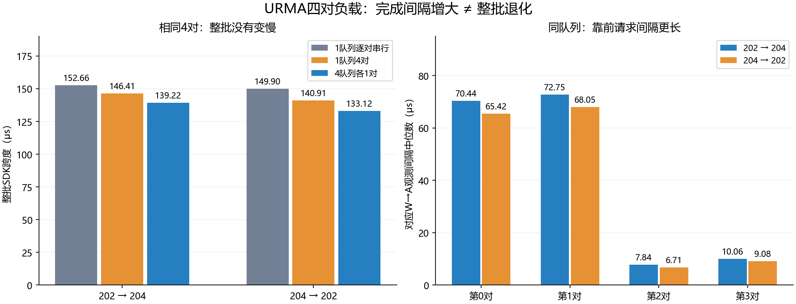

# URMA四对负载：同队列批内顺序产生完成间隔，但整批没有退化

输入结果提交`9b05da83`。开发端从两端原始samples重新运行analyze.py，六个CSV与上传的summary逐行一致。

## 1. 数据有效性

两端status均passed/correctness=true，各完成18个点，driver rc=0；来源overlay相同。三轮，每点20次预热、101次采样丢首值，共1800有效发送迭代、7200个有效WRITE/FADD对。两端分别绑CPU168/192，GPU NUMA均为2；内核均为`6.6.0-gdr_f00955680_diag`，AtomicCtl=0060、runpm_link=0。

三组固定每迭代四条459264B WRITE和四条加32的FADD。WRITE RELAX、FADD STRONG、per_request fence、completion all；源数据和远端计数器为GPU内存。单线程轮询、两个方向分别单向运行。分组差别是1队列逐对串行、1队列4对未完成、4队列各1对未完成。

所有点稳定：最大轮内整批CV为0.955%，最大轮均值跨度为0.725%。每点300次有效迭代、1200对。

## 2. 相同1837056B数据量的整批耗时

下表整批值为三轮迭代均值的中位数，不是单对平均数。

| 形态 | 202→204整批 μs | 204→202整批 μs | 两方向W→A中位 μs |
| --- | ---: | ---: | --- |
| serial4：1队列，逐对串行 | 152.657 | 149.901 | 0 / 0 |
| queue4：1队列，4对同时未完成 | 146.407 | 140.913 | 41.170 / 38.460 |
| lanes4：4队列，各1对未完成 | 139.223 | 133.118 | 0 / 0 |

queue4相对serial4整批减少4.09%/6.00%；lanes4相对queue4再减少4.91%/5.53%，相对serial4累计减少8.80%/11.20%。三轮逐轮比较方向一致，见contrasts.csv。



因此本轮没有“增加四对并发后整批反而变慢”的证据。单对在途时延可随排队增长，但它们重叠；不能把四个单对时延相加代替整批耗时。

## 3. 新增间隔集中在同队列靠前的请求

queue4按原Normal普通请求收集顺序排列：`W0 W1 W2 W3 A0 A1 A2 A3`，同队列一次SDK链式提交。

| 请求对位置 | 202→204 W→A中位 μs | 204→202 W→A中位 μs |
| --- | ---: | ---: |
| 0 | 70.440 | 65.420 |
| 1 | 72.750 | 68.045 |
| 2 | 7.840 | 6.710 |
| 3 | 10.060 | 9.080 |

不能把混合四个位置的41.17/38.46μs中位数当成每条FADD的固定耗时。

更细的同样本拆分，以位置0为例：

| 本端完成观测区间 | 202→204中位 μs | 204→202中位 μs |
| --- | ---: | ---: |
| W0完成→全部四条WRITE完成均取得 | 67.140 | 63.715 |
| 全部WRITE完成均取得→A0完成 | 3.290 | 1.690 |
| W0完成→A0完成 | 70.440 | 65.420 |

三个区间分别取中位数，前两行不要求精确相加等于第三行。逐样本按时间区间汇总，位置0的W→A间隔有95.31%/97.41%落在“尚未取得全部四条WRITE完成”的时间内。两个方向各300/300次A0观测均晚于或等于最后一个WRITE完成观测。

这是**观测区间的包含关系**：支持后续WRITE批内推进及顺序/排队参与了间隔，不是已经测出95%以上的设备执行原因；SDK完成交付、fence、设备内部依赖尚未独立拆开。

202发送的真实样本（第1轮index4，以首次SDK提交为0）：

```text
  0.00 μs  W0 W1 W2 W3 A0 A1 A2 A3同一链提交开始
  1.09 μs  提交返回
 69.58 μs  本端取得W0、W1完成
136.74 μs  本端取得W2、W3完成
140.02 μs  本端取得A0完成
142.32 μs  本端取得A1完成
144.56 μs  本端取得A2完成
146.77 μs  本端取得A3完成，整批结束
```

所以这一条W0→A0的70.44μs，并不等价于“A0自己在远端执行了70.44μs”。这段时间内，本端还在陆续取得后面的WRITE完成。

四队列各一对时，2400/2400个W/A对均同次SDK轮询返回；串行组同样2400/2400对。单队列四对组仅204发送方向3/1200对同批，202为0/1200。

## 4. 与原Normal异常的关系

本轮单队列四对的最大W→A间隔，202为79.30μs、204为73.01μs；7200对没有一个达到100μs。尚未复现此前完整Normal的682.990/427.350μs中位间隔。

可以推进的结论：

1. **URMA STRONG/fence不是无条件固定增加数百μs。**它们保留时，串行与四队列各一对都没有完成观测分离。
2. **同队列批内负载和通知排列能够产生明显的W→A完成观测分离。**完整FIFO/Proxy不是出现这种分离的必要条件，因为本轮直接使用生产UrmaTransport轮询。
3. **间隔变大与整批吞吐退化不是同一件事。**本轮间隔增大时整批反而改善，不能把它直接作为Normal退化的独立原因或可节省时间。
4. 更值得优先验证“多条WRITE尚在推进时，对应通知的完成观测被推后”是否随原Normal每线程的多队列、每队列多对负载放大。与当前数据相比，直接断言远端atomic执行本身很慢、或Proxy CPU已被证明是主因，都超出了证据。

仍缺同形态verbs对照；本轮只说明URMA内部行为，不证明这个机制在verbs中不存在。完整Normal的GPU消费者及head反馈可能把通知延后放大为背压，本轮没有测量这条因果链，不能拿8.8%/11.2%微基准改善当成完整dispatch优化收益。

## 5. 下一步收敛到一个因素

下一步恢复接近原Normal**单个Proxy的三条活跃数据队列**，比较每队列最多1对与4对未完成；固定每迭代12对、单线程绑核、同样注册区和顺序参数。

- 深度1：四轮，每轮三队列各一对，全部完成后推进下一轮。
- 深度4：三队列各四对，一轮全部提交。

保持总数据量相同，只增加每队列未完成对数；同一队列仍先WRITE后FADD。目的不是再验证已知单对时延，而是检查同队列已见的批内分离是否在三队列共享负载下放大到原Normal的数百μs。若未复现，再转向原Proxy持续服务、多线程及GPU/head反馈，不追加无依据的大参数矩阵。

对应脚本已经补充，直接按[depth12运行文档](../../DEPTH12.zh-CN.md)操作，使用新TREE/BUILD/JOB，不重测本轮四对组。

证据：[汇总](summary_urma/summary.csv)、[按请求位置](summary_urma/positions.csv)、[逐轮对照](summary_urma/contrasts.csv)、[原始双端结果](urma/cases/urma_pair_load_01_urma_run/)。
